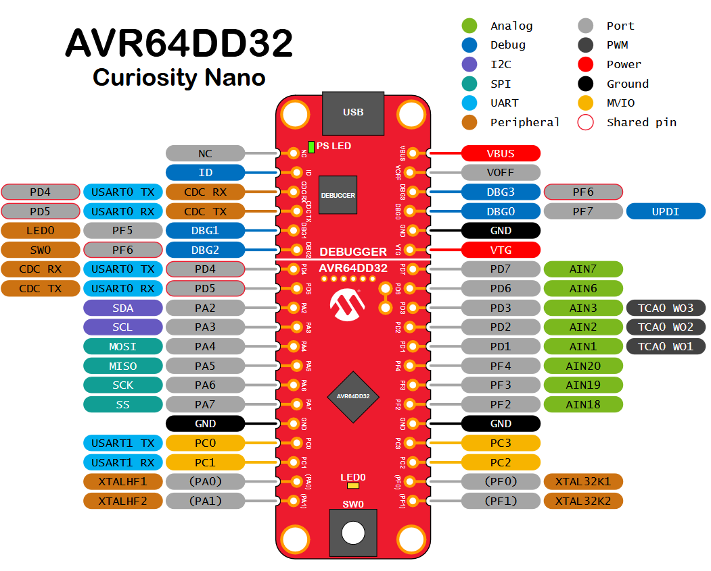

# ECSC preparation HW

These are some quick materials for ECSC 2025 preparation after they introduced the MCU used.

# Hardware

An AVR64DD32 Curiosity Nano development board was used. The target MCU is an AVR64DD32.

# Useful docs for AVR64DD32

[AVR64DD32/28 datasheet](https://ww1.microchip.com/downloads/aemDocuments/documents/MCU08/ProductDocuments/DataSheets/AVR64DD32-28-Complete-DataSheet-DS40002315.pdf)

The organizers provided [Preparation and prerequisites for solving hardware challenges](<ECSC 2025_ Preparation and prerequisites for solving hardware challenges-1.pdf>). It covers the recommended software, equipment and safety instructions for the competition.

# Toolchain

The preparation document recommends a Windows 11 VM, preferably using VMware Workstation Pro, with Microchip Studio for AVR and SAM Devices installed using the default choices.

# Challenges

[Challenge 1](challenge1/README.md) has an easy and a hard variant using the same source.

