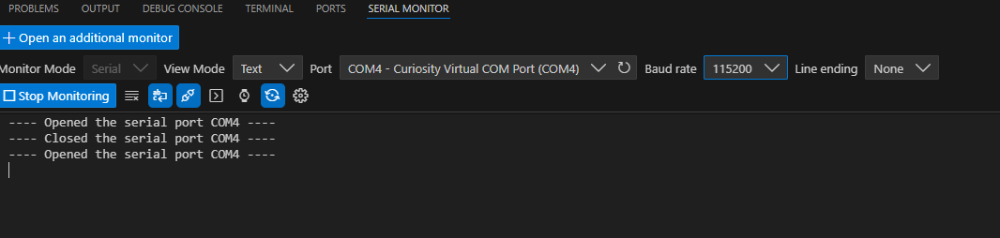
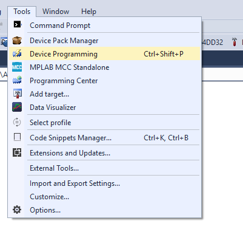
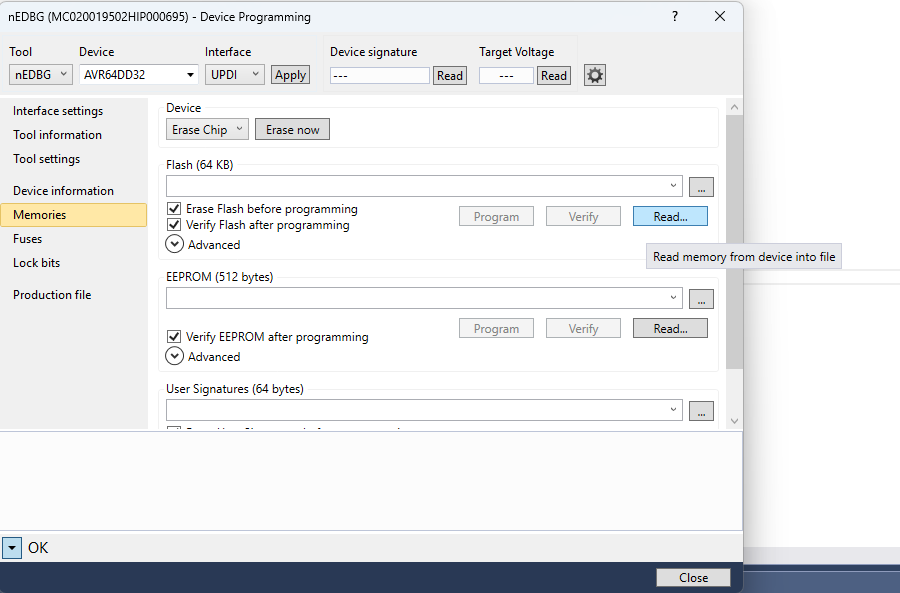
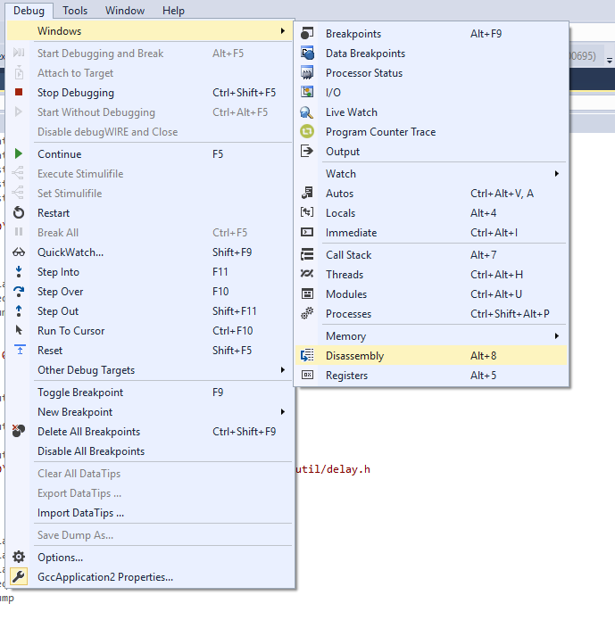
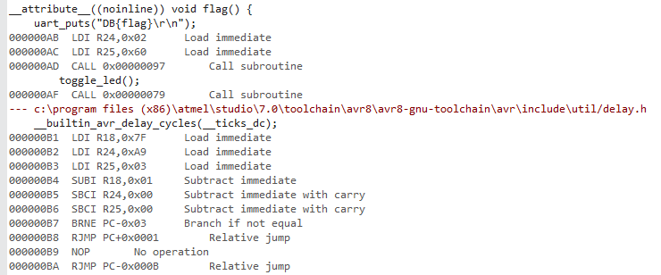
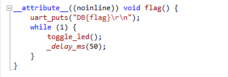
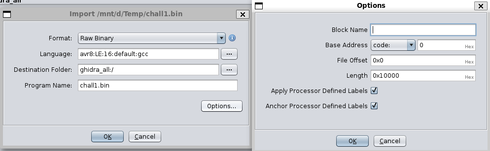
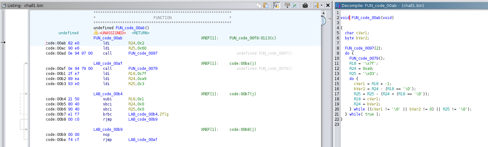

# Running it

The board connects as a Curiosity Virtual COM Port. The firmware starts an echo service on `115200` baud.

The VSCode serial monitor is a nice tool for connections.



# Microchip Studio

The official IDE is a Visual Studio based one from Microchip.

Use a GCC application template for the compilation.

The debugger can be started from `Debug > Start Debugging and Break`.

It is possible to create a project without source and just use the disassembly and memory to debug it.

## Device Programming

The board can be programmed from `Tools > Device Programming`. Select the `nEDBG` debugger, then program and verify the generated firmware.



Reading existing firmware can be done here as well.



## Disassembly

There is a dissasembly window when the project is open.



The disassembly shows the `flag()` function. In the easy build, its address is printed at startup.



For comparison, here is `flag()`.



# Ghidra

The firmware can also be exported and imported into Ghidra.

Import the binary as Raw Binary, with the `avr8:LE:16:default` language.



The `flag()` function can be found in the disassembly. It calls the UART print function and then toggles the LED.



# Overflow

The echo function reads characters into a 32 byte buffer until CR or LF. It does not check the length, so longer input overwrites the return address.

On AVR, program and data memory are separate, it is a modified Harward architecture. The code can be accessed as memory, but memory can not be executed. The return address is a program memory address, so the saved return address can be replaced, like in ROP. 

In this case, simply with the address of `flag()`.

For the easy version, the address is printed at startup. The input is 35 `A` bytes, followed by the 2 address bytes in little endian, then LF and CR.

```text
41 41 41 41 41 41 41 41 41 41 41 41 41 41 41 41 41 41 41 41 41 41 41 41 41 41 41 41 41 41 41 41 41 41 41 XX XX 0a 0d
```

For the hard version, the address has to be found in the disassembly. The exact address depends on the compiled firmware.