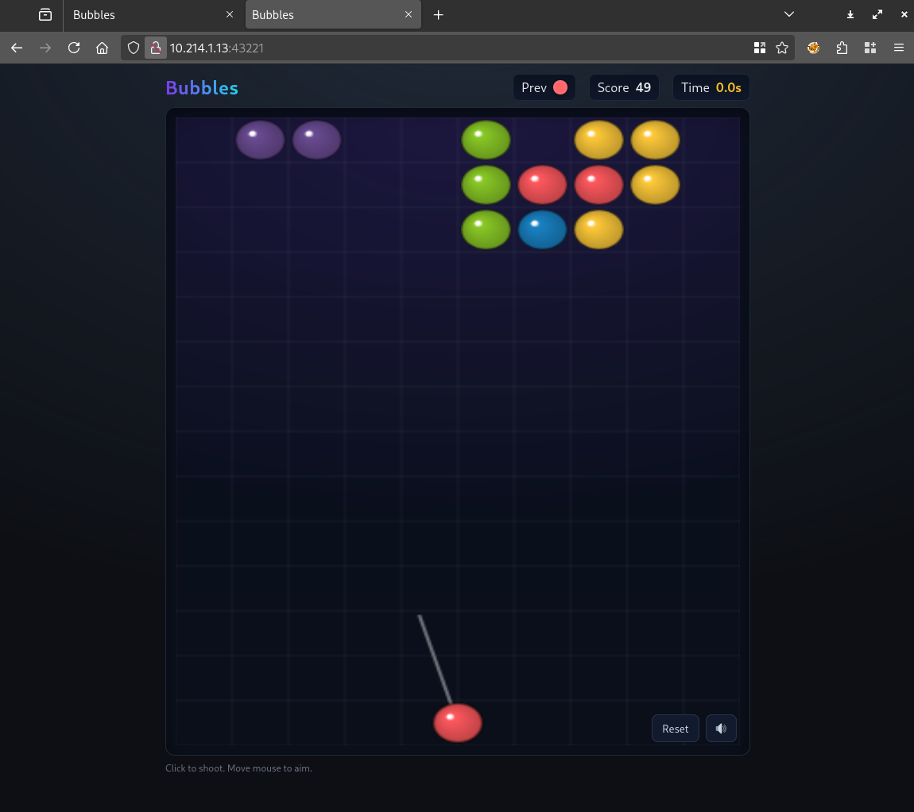
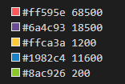
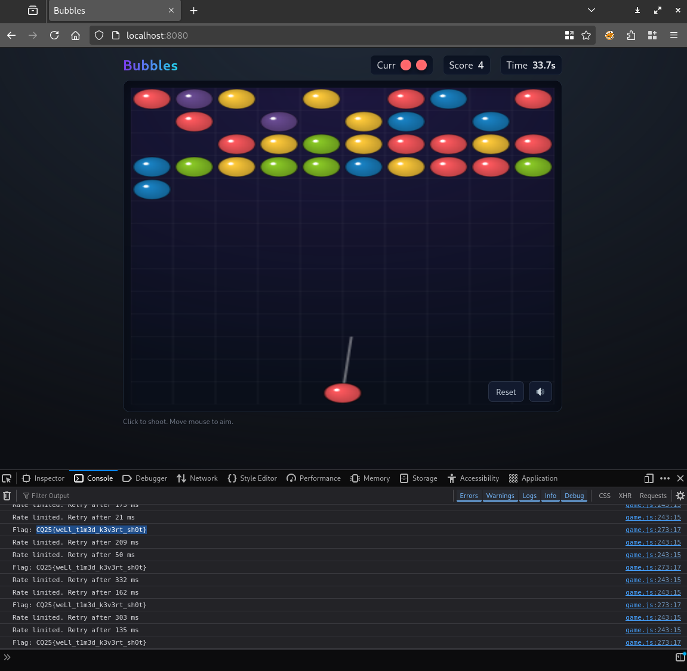
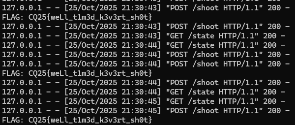
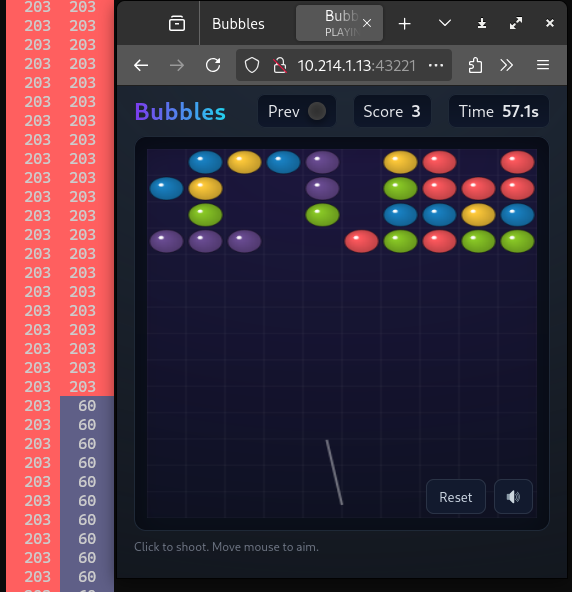
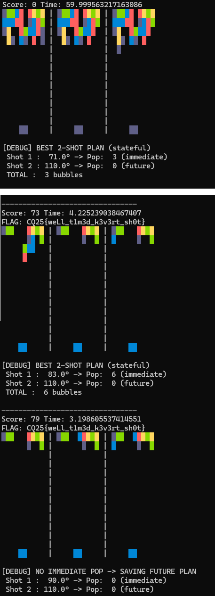
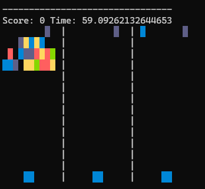

# Visiting the site

There is a minigame on the site. Something is off. The next ball is unknown, we only know the previous one.

# Source code

The source code was also available. Reviewing the following observations can be made.

## Board

The board is randomized with various colors.

## Flag

The flag is handed out when you reach over 70 ponts. It is also printed to the javascript console on client side when received.

## Score

Grouping 3 or more adjacent bubbles of the same color give points. There is no reward for popping bigger clusters. Also every floating bubble is popped that is not connected to the top.

## Next bubble

The next bubble is determined based on the a `pytorch` model using the current epoch timestamp in a 2 seconds window. Generating a bunch of options on the model, yellow and green is very unlikely. It is usually red, and sometimes purple or blue.

The [color_distribution.py](workdir/color_distribution.py) was used to check distribution.

## Reset

Resetting the board does not reset the timer unfortunately, but it resets the score.

# Predictor

As the model is available, we can predict the current color (and the next ones). To reuse the server code, the required packages should be installed via pip (`torch`, `fastapi`).

To counter some of the issues above, a reverse proxy can be made that can patch certain things for the client side. 

The state is patched. The previous color is replaced with the current one and the next one is also added.

On the client side, both the previous and next colors are shown by patching the HTML and JS.

The reset button is also patched. Clearing the cookies (and for this making them not http only) resets the session id and that resets the timer.

Implemented in [reverse_proxy.py](workdir/reverse_proxy.py). Also prints the flag if received.

# Game

Playing on the modified client is easier. After getting the hang of it and resetting the board to a suitable one (with lot of red and lot of floating colors), it can be won manually. It took around 5-10 minutes this way.

# Flag
`CQ25{weLl_t1m3d_k3v3rt_sh0t}`

# Finals

During the finals, a more barebone solution was used. The colors were rendered to a terminal window behind the browser with [predict.py](workdir/predict.py). Resetting manually by deleting the cookie in dev tools.

# Automated bot

Instead playing manually, a bot can be made to use the predicted color. The easiest is just to reuse the server side logic entirely, like in [bot.py](workdir/bot.py). It does a 2 pass prediction with 41 shooting angles, and selecting the highest poppers greedily. To avoid some loops, it is following the second prediction in case the first resulted 0 pops. 

This worked well in most cases.

Or a lucky board can be used with instant win.

