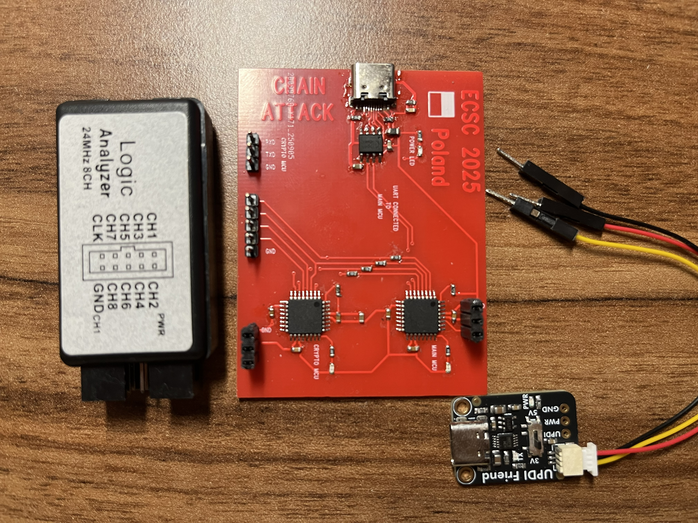
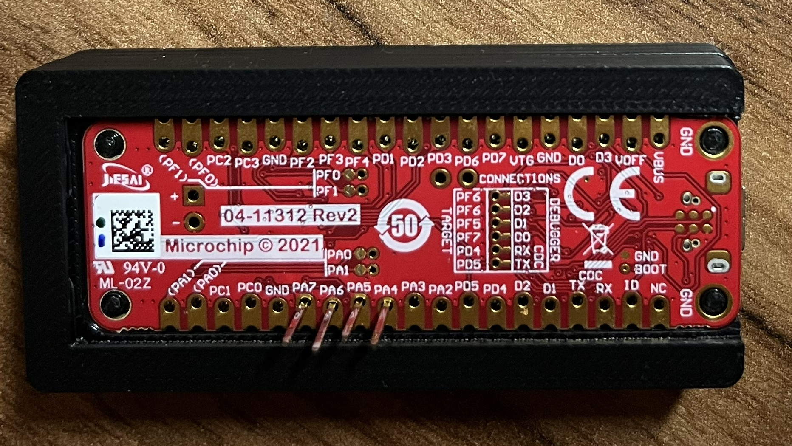

# ECSC25 HW challenge

Hardware challenge from ECSC 2025 ("chain attack"). The board has two AVR64DD32 MCUs (`Main` and `Crypto`) connected to each other. 

The MCUs are connected with 4 wires. The boards had tap points on this bus.

# Hardware

The connections between the 2 MCUs:

```
Main <-> Crypto
	PA4 <- 100 -> PA4
	PA5 <- 100 -> PA5
	PA6 <- 100 -> PA6
	PA7 <- 100 -> PA7
Main
	PA2 pulled up to VCC (4.7k)
Crypto
	PA2 pulled down to GND (4.7k)
LED on both
	PF4 <- 2.2k -> LED
```



# Logic Analyser

A Saleae logic analyser (or clone) was provided and can be used to sniff on the tap ponints.

If you don't have a logic analyser, use [logic_analyser_run.sr](workdir/logic_analyser_run.sr) and [logic_analyser_run_uart.txt](workdir/logic_analyser_run_uart.txt) as an exammple run.

# Firmware

Normally the firmware was not available to the players. They were flashed with flash and ram protection, so reading them via UPDI is not available. Do not use these for solving. The flag is also there in plaintext.

The original firmware is in [ecsc25-chain-attack-fw.7z](files/ecsc25-chain-attack-fw.7z), together with a readme about flashing. It has a safeguard for the 2 different MCUs, so they can not be flashed incorrectly.

# Alternative

As an alternative, the firmwares were binary patched to work on 2x Curiosity Nano AVR64DD32 dev boards. They have no safeguards for the MCUs. The `unlocked` versions have no check for the locking:

| MCU | ECSC | Curiosity Nano |
|---|---|---|
| Main | [EnigmaMainMCUFW2_unlocked.hex](files/EnigmaMainMCUFW2_unlocked.hex) | [EnigmaMainMCUFW2_unlocked_nano.hex](files/EnigmaMainMCUFW2_unlocked_nano.hex) |
| Crypto | [EnigmaCryptoMCUFW_unlocked.hex](files/EnigmaCryptoMCUFW_unlocked.hex) | [EnigmaCryptoMCUFW_unlocked_nano.hex](files/EnigmaCryptoMCUFW_unlocked_nano.hex) |

Just connect the PA-4-5-6-7 ports.



In case you don't have 2 boards, you can use any other MCU with SPI capabilites to solve the challenge, just use the provided logic analyser capture again.

# Writeup

[Writeup](WRITEUP.md)
