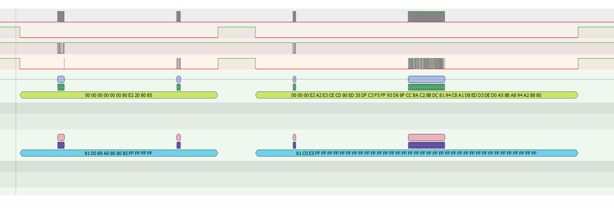
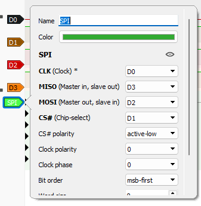
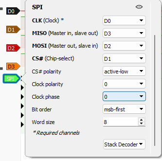
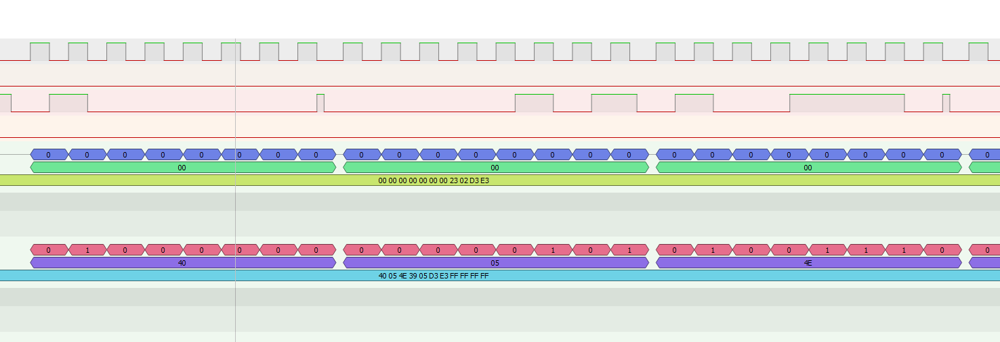
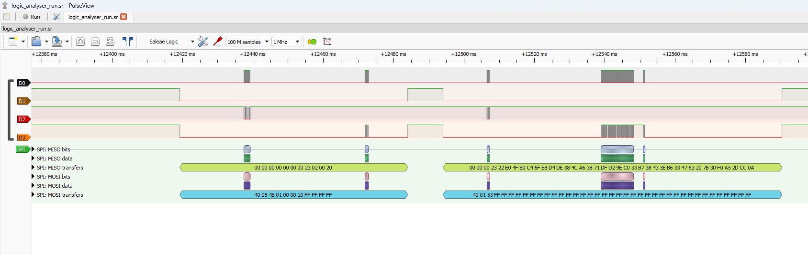
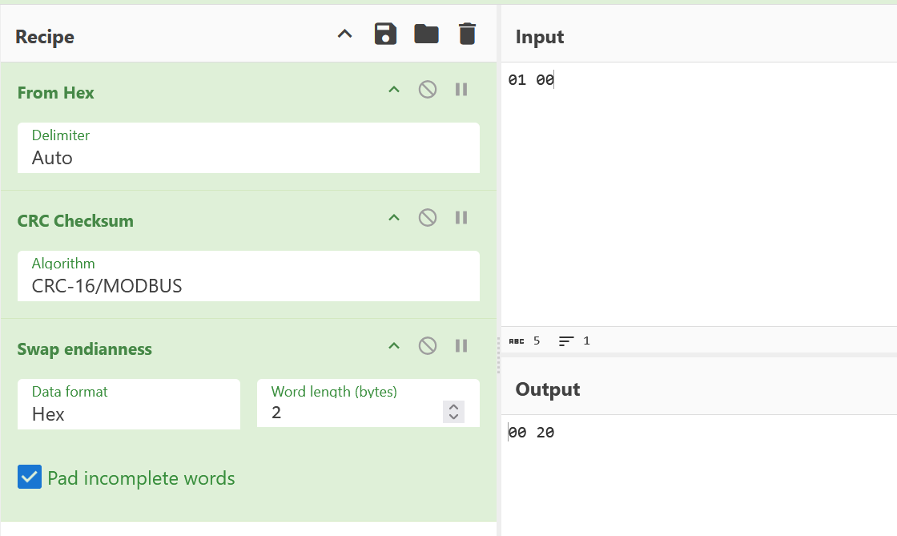
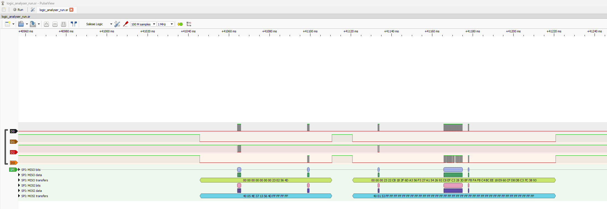
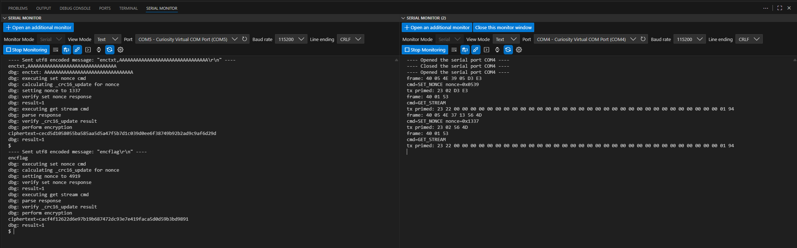

# Console

The board has a serial console, connected to the `Main` MCU.

```
$ help
Available commands:
  debug             - enable debug printouts until next poweroff
  encflag           - encrypt flag and return it
  setnonce,[nonce]  - set nonce to use
  enctxt,[text]     - encrypt arbitrary text
$ setnonce,4919
error: not allowed to set nonce=4919
result=0
$ setnonce,1
result=1
$ enctxt,test123
ciphertext=0c8aa1fe578e32
$ enctxt,test123test
ciphertext=0c8aa1fe578e3233ddec63
$ encflag
ciphertext=f49eb500de2c7cfdf49f0a7ff16b25b838d4814aa056190909435a
```

 - `debug` turns on some extra printouts
 - `encflag` encrypts the flag, always the same result
 - `setnonce` sets the nonce of the encryption
 - `enctxt` encrypts the text with the current nonce

# Debug

The `debug` command turns on extra messages, which show the steps of the encryption.

```
$ debug
dbg: enabled debugging
$ setnonce,4919
dbg: set nonce to 4919
error: not allowed to set nonce=4919
result=0
$ setnonce,1
dbg: set nonce to 1
dbg: current nonce=1
result=1
$ enctxt,test123
dbg: enctxt: test123
dbg: executing set nonce cmd
dbg: calculating _crc16_update for nonce
dbg: setting nonce to 1
dbg: verify set nonce response
dbg: result=1
dbg: executing get stream cmd
dbg: parse response
dbg: verify _crc16_update result
dbg: perform encryption
ciphertext=0c8aa1fe578e32
dbg: result=1
```

The messages show that the nonce is sent to the other MCU with a CRC16, and then the keystream is requested, also with a CRC16 check. The communication between the 2 MCUs is not visible from the console.

# Encryption

The ciphertext of a text is the prefix of the ciphertext of a longer one, so it is a stream cipher. Different nonces give different ciphertexts.

The nonce of the flag is `4919` (`0x1337`) and it is blocked in the console. With a known plaintext and the same nonce the keystream could be recovered and the flag decrypted.

# Sniffing

The `Main` MCU sets up the `Crypto` MCU with the nonce over SPI and asks for a keystream. The 4 wires have tap points, so a logic analyser was connected to them.

A run was captured with [PulseView](https://sigrok.org/wiki/PulseView) as [logic_analyser_run.sr](workdir/logic_analyser_run.sr) and [logic_analyser_run_uart.txt](workdir/logic_analyser_run_uart.txt).

It was tested with nonce `1`/`2`/`1337` and with `4919` indirectly with `encflag`.

The 4 wires suggest SPI. The SPI decoder settings in PulseView. Clock and CS can be identified easily. MOSI and MISO can be swapped if identified incorrectly, they decode the same. Polarity, phase and bit order are the main question.



# SPI

After trying various settings, the common SPI default works: mode 0, MSB first, active low CS. 

 


This reveals some messages with the nonce in it. Like `1337` is `39 05` in 16 bit little endian, also nice `00` and `FF` while talking, confirming the SPI settings and the directions.
 


# Protocol

MISO sets the bytes to `00` while the other side is talking, MOSI sets the bytes to `FF`.

Every encryption has 2 transfers. The nonce is only set when encryption is requested, not when the command was sent.

Checking the different nonces, like `1` as example here.



```
MOSI: 40 05 4e 01 00 00 20
MISO: 00 00 00 00 00 00 23 02 00 20
MOSI: 40 01 53
MISO: 00 00 00 23 22 e0 4f b0 c4 6f e8 d4 de 38 4c a6 38 71 df d2 9e c0 33 b7 38 43 3e b6 33 47 63 20 7b 30 f0 a5 2d cc 0a
```

The `40 05 4e` is the same prefix for the nonce and the `40 01 53` is the same for the keystream.

Based on the debug message, the CRC is also 16 bits. Fiddling on [crccalc.com](https://crccalc.com/?crc=01+00&method=CRC-16&datatype=hex&outtype=hex), the `01 00` checked with `CRC-16/MODBUS` results in `00 20` on the wire as little endian. The command prefix is not checked.



Similarly checking the other bytes, the protocol is like this.

```
SET_NONCE:  40 05 4e <nonce LE16> <CRC16>  -> 23 02 <CRC16 from set>
GET_STREAM: 40 01 53                       -> 23 22 <32 bytes keystream> <CRC16>
```

The flag encryption sets `37 13` (`0x1337`).



```
cb1b2f6da356f327a1542692c8efc3283dbffbfafbc4bcee18e960cfd8dbc37c
```

# Crypto MCU

The nonce of the flag cannot be set, but the keystream can be controlled on the other side. If the keystream is the same for the flag and for a known text, they can be decrypted.

```
keystream = ciphertext(enctext) ^ enctext
flag = ciphertext(flag) ^ keystream
```

The `Crypto` MCU firmware was replaced with [main.c](workdir/main.c). It is an SPI client, it parses the frames and replies with

 - the same CRC for `SET_NONCE` that was in the request
 - an all zero keystream with a valid CRC for `GET_STREAM`

It also prints the received frames on a UART.



The `enctxt` (nonce `1337`) and the `encflag` (nonce `4919`) are using the same keystream now. Any extracted keystream would have worked as well.

# Decrypting

The encryption of a known text gives the effective keystream, and that decrypts the flag.

```py
pt_enctext = b"A" * 32
ct_enctext = bytes.fromhex("cecd5d1058055ba585aa5d5a47f5b7d1c039d0ee6f38749b92b2ad9c9af6d29d")
ct_encflag = bytes.fromhex("cacf4f12622d6e97b19b687472dc93e7e419faca5d0d59b3bd9891")

keystream = bytes(c ^ p for c, p in zip(ct_enctext, pt_enctext))
pt_flag   = bytes(c ^ s for c, s in zip(ct_encflag, keystream))
print(pt_flag.decode())
```

# Flag

`ECSC{itsuptotheweakestlink}`
