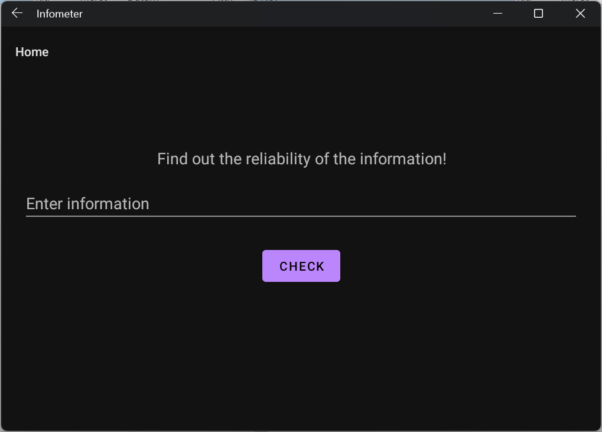
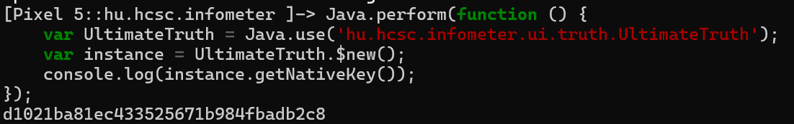
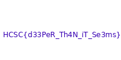
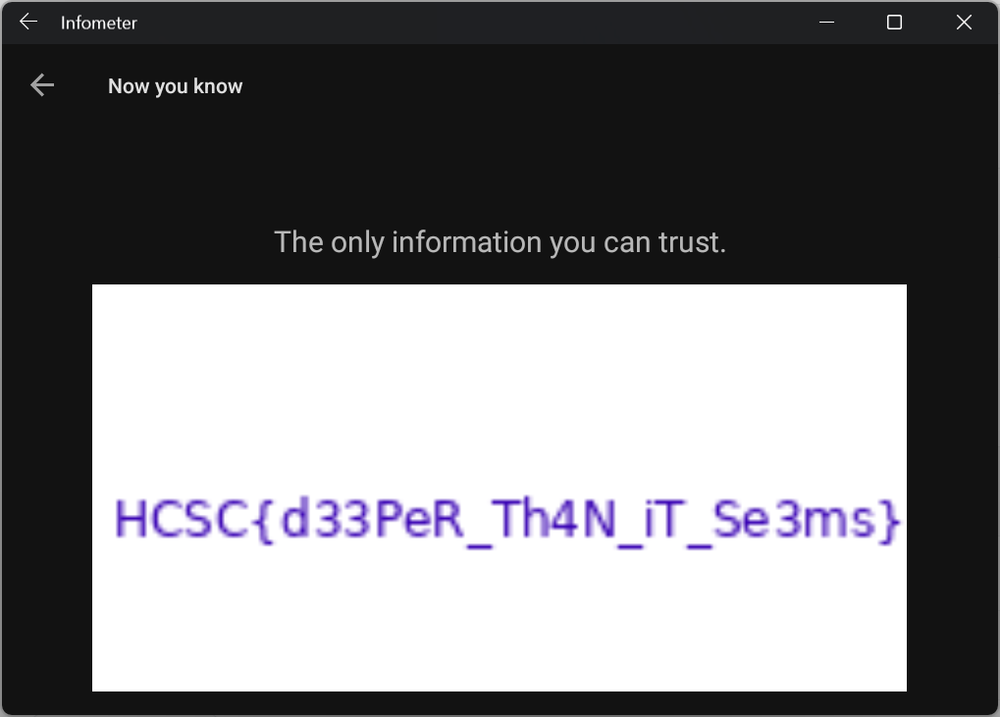

# App

The app accepts text and claims to check how reliable the supplied information is.



# APK

Looking through it with JADX, the interesting package is `hu.hcsc.infometer.ui.truth`, with the `UltimateTruth` class.

It also has has 3 fragments, including that class:
- `hu.hcsc.infometer.ui.home.HomeFragment`
- `hu.hcsc.infometer.ui.calc.Result`
- `hu.hcsc.infometer.ui.truth.UltimateTruth`

# Reverse

At first, this looks like a normal Android reversing task. `UltimateTruth` loads `native-lib` and gets the AES key through `getNativeKey()`, so the natural next step is to open `libnative-lib.so` in a native-code disassembler and recover the key. Then decrypting [encrypted_data.txt](workdir/encrypted_data.txt).

The hardcoded string suggests this is not the intended solution.

```java
    private final String f1268a = "th15_1s_n0t_a_r3v_t45k";

    public UltimateTruth() {
        System.loadLibrary("native-lib");
    }

    private final Bitmap b(Context context) {
        try {
            byte[] e = e(context); // InputStream open = context.getAssets().open("encrypted_data.txt");
            byte[] g = g();
            SecretKeySpec secretKeySpec = new SecretKeySpec(g, "AES");
            IvParameterSpec ivParameterSpec = new IvParameterSpec(g);
            Cipher cipher = Cipher.getInstance("AES/CBC/PKCS5Padding");
            cipher.init(2, secretKeySpec, ivParameterSpec);
            byte[] doFinal = cipher.doFinal(e);
            Intrinsics.b(doFinal);
            return BitmapFactory.decodeStream(new ByteArrayInputStream(i(h(doFinal), this.f1268a)));
        } catch (Exception unused) {
            return null;
        }
    }

```

# Frida

The native key can be observed dynamically.

```bash
frida -U -f hu.hcsc.infometer
```

```javascript
Java.perform(function () {
    var UltimateTruth = Java.use('hu.hcsc.infometer.ui.truth.UltimateTruth');
    var instance = UltimateTruth.$new();
    console.log(instance.getNativeKey());
});
```

```
d1021ba81ec433525671b984fbadb2c8
```



There are multiple routes now. Reimplement the decryption, navigate to the fragment, or just dump the bitmap. 

# Bitmap

Overwriting the button click to dump the bitmap to the SD card.

```javascript
Java.perform(function () {
    var HomeFragment = Java.use('hu.hcsc.infometer.ui.home.HomeFragment');
    var func = HomeFragment.onViewCreated$lambda$0.overload(
        'hu.hcsc.infometer.ui.home.HomeFragment',
        'android.view.View'
    );

    func.implementation = function (fragment, view) {
        var UltimateTruth = Java.use('hu.hcsc.infometer.ui.truth.UltimateTruth');
        var FileOutputStream = Java.use('java.io.FileOutputStream');
        var CompressFormat = Java.use('android.graphics.Bitmap$CompressFormat');

        var instance = UltimateTruth.$new();
        var bitmap = instance.b(fragment.requireContext());
        var out = FileOutputStream.$new('/sdcard/Download/bitmap.png');
        bitmap.compress(CompressFormat.PNG.value, 100, out);
        out.close();
    };
});
```

After clicking.

```bash
adb pull /sdcard/Download/bitmap.png
tesseract bitmap.png bitmap && cat bitmap.txt

```bash
frida -U -f hu.hcsc.infometer -l dump.js
```

# Bitmap

```bash
tesseract bitmap.png bitmap
cat bitmap.txt
```


# Flag

`HCSC{d33PeR_Th4N_iT_Se3ms}`


# Fragment navigation

Alternatively a fragment manager frida [script](workdir/navigateTo.js) can be used.

```bash
frida -U -f hu.hcsc.infometer -l navigate.js
```

```
navigateTo('navigation_home')
navigateTo('navigation_result')
navigateTo('navigation_truth')
```



# Decrypting

Another alternative is a decryption [script](workdir/decrypt.py) that can recover an image.


