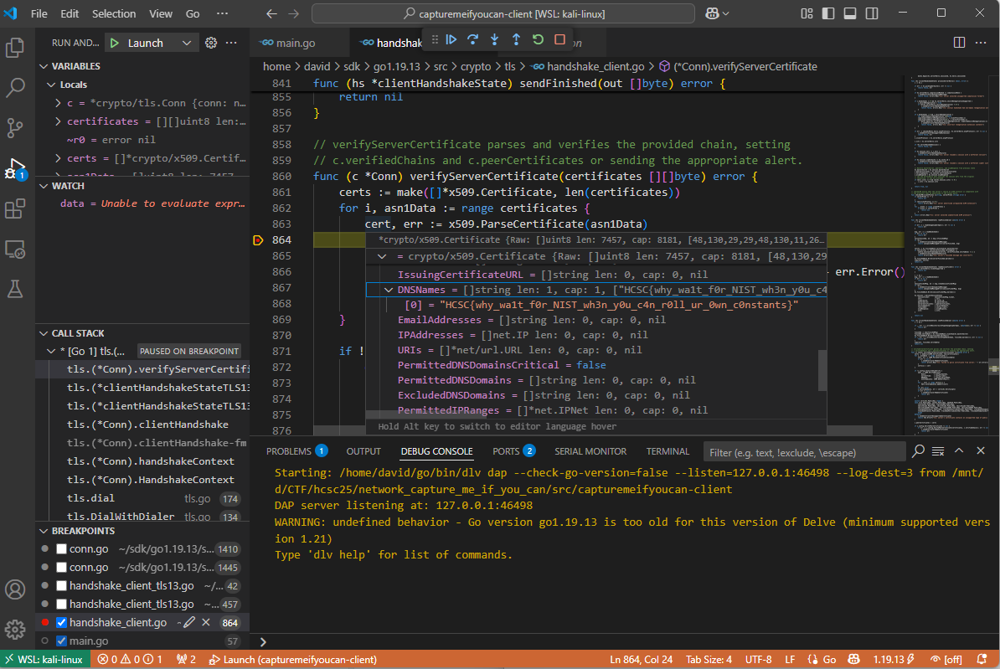
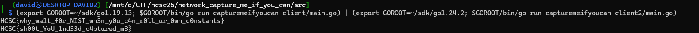

# Service

The first challenge service is listening on port `1337`. It is a TLS service, but fails with regular OpenSSL.

```bash
openssl s_client -connect 10.10.1.10:1337 -tls1_3 -brief -showcerts
```

```
Connecting to 10.10.1.10
4017E668EA7F0000:error:0A000410:SSL routines:ssl3_read_bytes:ssl/tls alert handshake failure:../ssl/record/rec_layer_s3.c:918:SSL alert number 40
```

# Source

The source has 2 services. `capturemeifyoucan-keyprovider` is listening on port `1337`.

The keyprovider Dockerfile replaces the Go crypto library with [PQCrypto](https://github.com/buyobuyo404/PQCrypto/tree/7c72383fe0c358ec12bf8e91e4dbe6b1d537f8a0).

```dockerfile
RUN rm -rf $(go env GOROOT)/src/crypto && \
    git clone --depth 1 --branch master --single-branch https://github.com/buyobuyo404/PQCrypto.git $(go env GOROOT)/src/crypto
```

This adds Dilithium5 support to it.

```go
privateKey, err := dilithium5.GenerateKey()
// ...
cert, err := generateCertificate(privateKey, publicKey)
```

In [tls/common.go](https://github.com/buyobuyo404/PQCrypto/blob/7c72383fe0c358ec12bf8e91e4dbe6b1d537f8a0/tls/common.go), the old PQCrypto TLS implementation defines `Dilithium5` as TLS signature scheme `0x080c` (`2060`).

```go
Dilithium5               SignatureScheme = 0x080C
```

Current OpenSSL offers the standardized ML-DSA signature schemes instead. The server needs the legacy Dilithium5 scheme, while OpenSSL only offers ML-DSA, this is why the handshake fails.

# Client

A client was written using the patched Go TLS implementation. It connects to the first service and disables certificate verification.



Stopping after the certificate has been parsed, at `crypto/tls/handshake_client.go:864`, reveals the flag in its DNS name.

Looking at the source afterwards confirms this. The keyprovider creates a certificate with the flag as its only DNS name.

```go
template := x509.Certificate{
    Subject: pkix.Name{
        Organization: []string{"Honeylab"},
    },
    DNSNames: []string{flag},
    // ...
}
```

# Flag 1
`HCSC{why_wa1t_f0r_NIST_wh3n_y0u_c4n_r0ll_ur_0wn_c0nstants}`

# Response

The response from port `1337` is Base64 encoded and cannot be used directly. The client decrypts it using SM4-CBC with the hardcoded key `radiofrequencies`, the same key the service uses to encrypt it:

```go
func encryptData(data string) string {
    key := []byte("radiofrequencies")

    encrypted, err := sm4.Sm4Cbc(key, []byte(data), true)
    // ...
    return base64.StdEncoding.EncodeToString(encrypted)
}

// in handleConnection:
conn.Write([]byte(encryptData(clientKey) + "\n"))
```

The [capturemeifyoucan-client](workdir/capturemeifyoucan-client) was modified afterwards to also decrypt the provided key to stdout (so it can be used in the second challenge) and also printing the flag (DNS name) to stderr.

# Second service

The second challenge, `capturemeifyoucan-backend`, is on port `8443`. Supplying the private key and certificate received from the first service authenticates to it. Calling the `/api/v1/flag` endpoint returns us the flag.

```go
http.HandleFunc("/api/v1/flag", func(w http.ResponseWriter, r *http.Request) {
    if r.TLS == nil || len(r.TLS.PeerCertificates) == 0 {
        http.Error(w, "Client certificate required", http.StatusUnauthorized)
        return
    }
    _, _ = w.Write([]byte(flag))
})

TLSConfig: &tls.Config{
    MinVersion:       tls.VersionTLS13,
    CurvePreferences: []tls.CurveID{tls.X25519MLKEM768},
    ClientCAs:        clientCertPool,
    ClientAuth:       tls.RequireAndVerifyClientCert,
},
```

The [capturemeifyoucan-client2](workdir/capturemeifyoucan-client2) client reads the two PEM blocks from stdin and uses them as a TLS client certificate, then calls the flag endpoint.

The tricky part is that the two clients need different Go versions. The first client has to run on the patched Go 1.19, because the PQCrypto fork (with Dilithium5 and the liboqs bindings) only works there. That Go has no support for the hybrid post-quantum key exchange `X25519MLKEM768`, which the second service requires (TLS 1.3 only). So the second client is built with a stock Go 1.24, whose `crypto/tls` supports that exchange.

```bash
(export GOROOT=~/sdk/go1.19.13; $GOROOT/bin/go run capturemeifyoucan-client/main.go) | (export GOROOT=~/sdk/go1.24.2; $GOROOT/bin/go run capturemeifyoucan-client2/main.go)
```



# Flag 2
`HCSC{sh00t_YoU_1nd33d_c4ptured_m3}`
