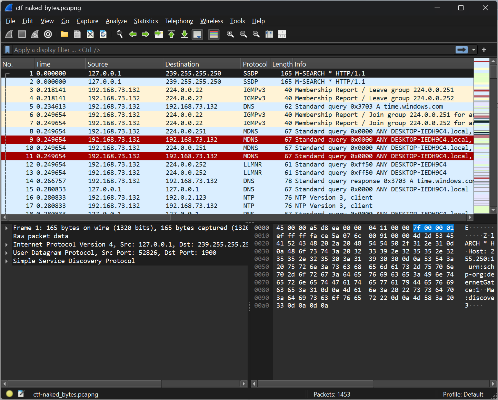
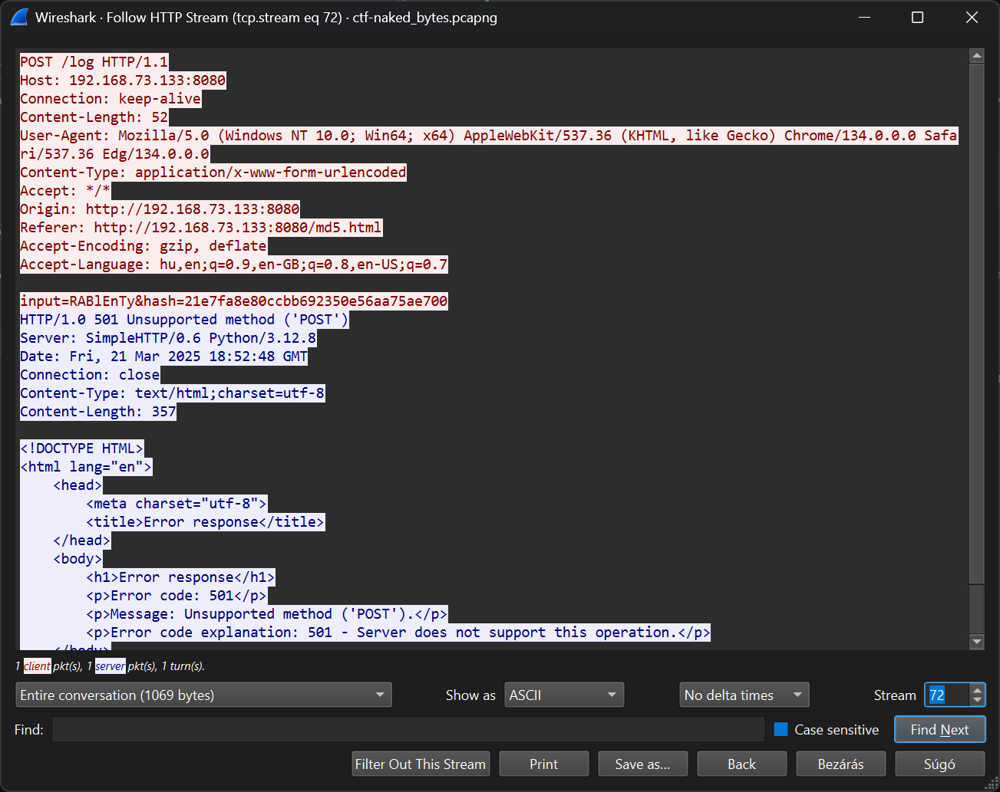
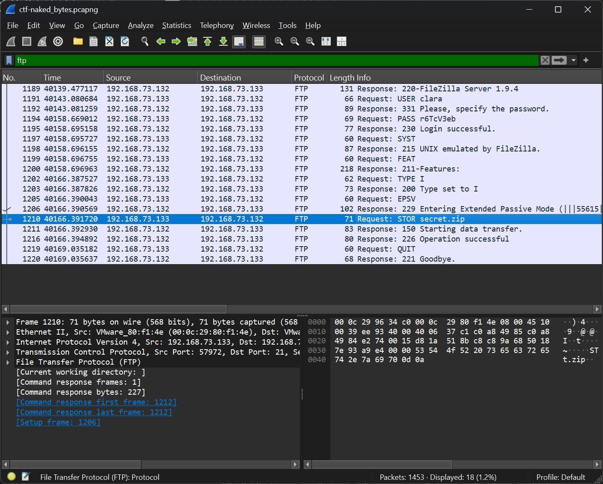

# Pcap

Opening the pcap with Wireshark, there are a lot of nonsense connections.



# HTTP

The web server on `192.168.73.133` serves `md5.html`. A `POST /log` sends an input and its MD5 hash.



```
RABlEnTy
21e7fa8e80ccbb692350e56aa75ae700
```

# FTP

The FTP login is in plain text (`clara:r6TcV3eb`) and `secret.zip` is uploaded. The [secret.zip](workdir/secret.zip) can be extracted from the data stream.



# Secret zip

The zip is encrypted with ZipCrypto and contains `flag.txt`. The FTP password and the HTTP input do not work, the MD5 hash from the HTTP request does.

```bash
unzip -P 21e7fa8e80ccbb692350e56aa75ae700 -p secret.zip
```

# Flag
`HCSC{pAcK3t_C4pTuR3_rEvEaLs_4LL}`
