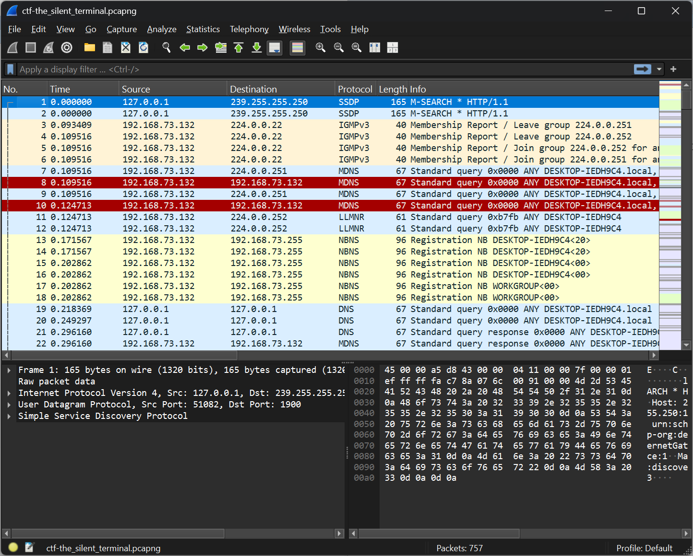
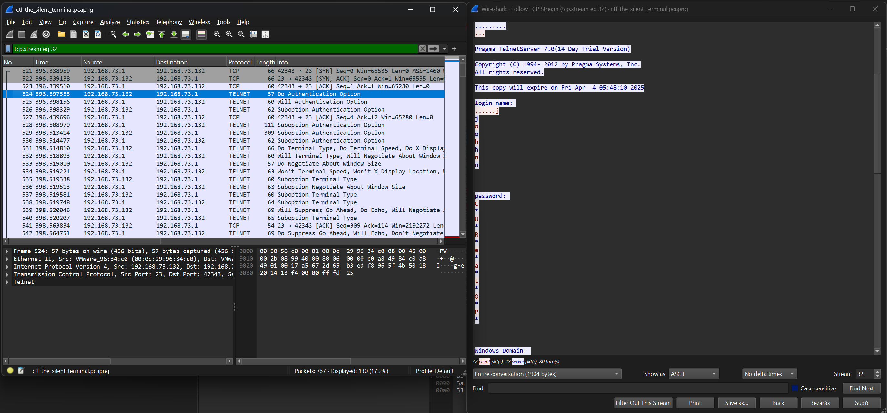
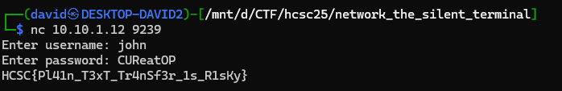

# Zip

The zip contains a network capture.



# Telnet

There is a telnet session, with credentials inside.



The credentials are `john:CUReatOP`.

# Terminal

Connecting to the service with the credentials returns the flag.

```bash
nc 10.10.1.12 9239
```



# Flag
`HCSC{PL41n_T3xT_TrnSf3r_1s_R1sKy}`