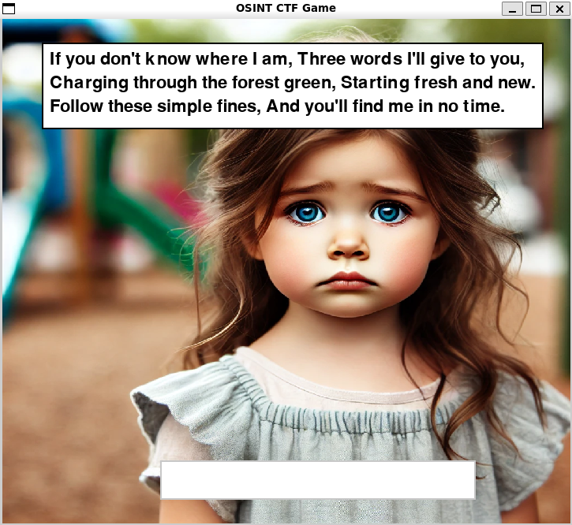
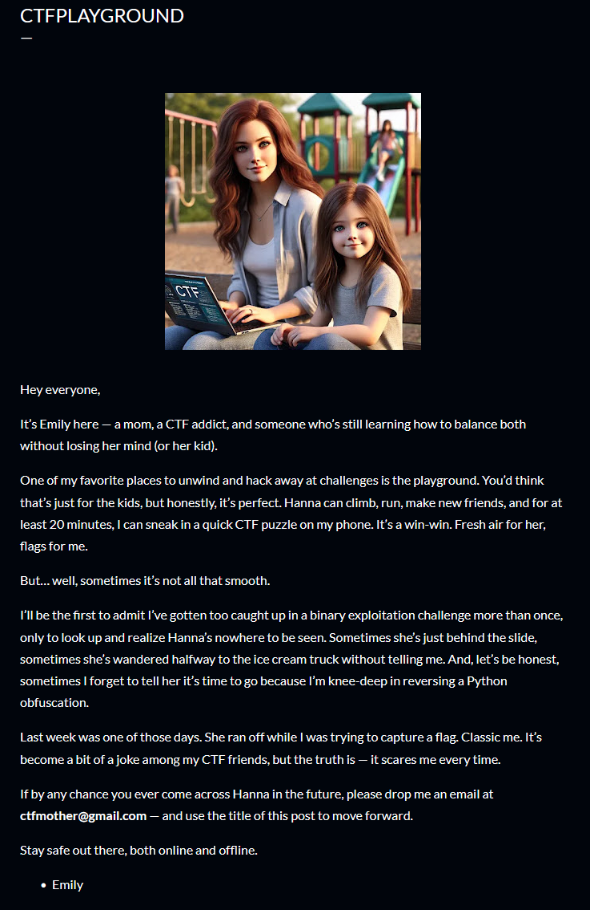
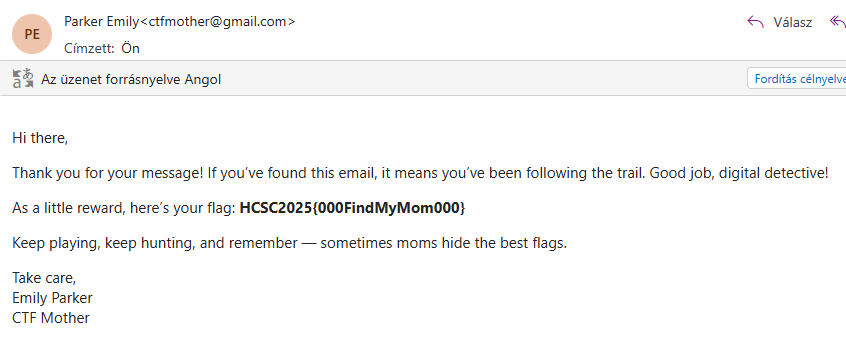

# The binary

The application itself is an AI-generated pygame game: Hanna loses her mom, gives you two riddles, and you type the answers into input boxes. The whole thing has the usual AI slop feel to it.

# Reverse

The challenge file is a stripped PyInstaller executable. Extracting it with [pyinstxtractor](https://github.com/extremecoders-re/pyinstxtractor) gives [`FindMyMom1.pyc`](workdir/FindMyMom1.pyc), which can be decompiled with [PyLingual](https://pylingual.io) into [`FindMyMom1.pyc_Decompiled.py`](workdir/FindMyMom1.pyc_Decompiled.py).

The answers are checked as `sha256(input + 'some_random_secret_key')`. Because the plaintext answer is concatenated with the secret before hashing, both answers are sitting right there in the decompiled code. Great security.

```python
CORRECT_HASH_1 = hashlib.sha256(("CtfMother" + SECRET_KEY).encode()).hexdigest()
CORRECT_HASH_2 = hashlib.sha256(("CtfPlayground" + SECRET_KEY).encode()).hexdigest()
```

Entering them in the game finishes it, but it only prints "Thank you!". The flag is not in the binary.

# Blog

The first riddle suggests a what3words address.



```
If you don't know where I am, Three words I'll give to you,
Charging through the forest green, Starting fresh and new.
Follow these simple fines, And you'll find me in no time.
```

The text contains a lot of valid w3w words:

```
charging
forest
green
starting
fresh
follow
these
simple
fines
lines // typo?
```

You need to guess these three: `charging.starting.fines`. The word `fines` is not actually a typo. The flag has nothing to do with the place it marks, either.

Searching it leads to a Blogspot [blog](https://ctfmother.blogspot.com/2025/03/everyone-its-me-again-emily.html).


# Playground

The second riddle points to a playground. The blog has a post titled [CTFPLAYGROUND](https://ctfmother.blogspot.com/2025/03/ctfplayground.html), with the mother's email address and instructions to send an email to it.



# Email

Sending an email with the post title as the subject gets the flag in the reply.



# Flag
`HCSC2025{000FindMyMom000}`
