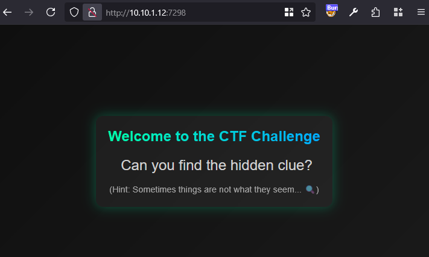
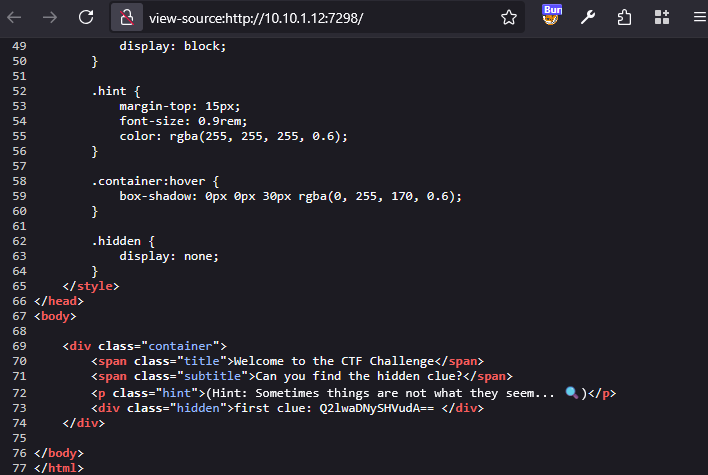
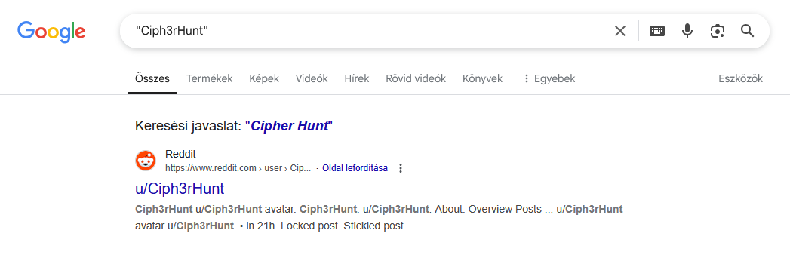
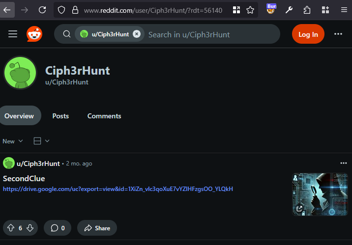
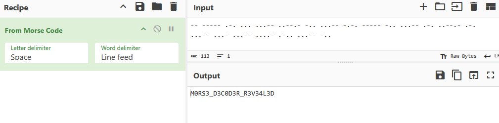

# Website

Visiting the website, there is a simple [static page](workdir/CTF-Challenge.htm).



It has a hidden `<div>`, containing a base64 string.



```
Q2lwaDNySHVudA==
```

Decoding it twice gives the Reddit username `Ciph3rHunt`.

# Reddit

Searching for it via Google results in a reddit user.




The user has a post with a Google Drive link to [download.jpg](workdir/download.jpg).



# Image


The image has some Morse code inside the Comment tag.

```bash
exiftool download.jpg 
```

```
Comment                         : -- ----- .-. ... ...-- ..--.- -.. ...-- -.-. ----- -.. ...-- .-. ..--.- .-. ...-- ...- ...-- ....- .-.. ...-- -..
```

A Morse code decoder can be used to decode it to the flag. Cyberchef was used this time.



# Flag
`HCSC{M0RS3_D3C0D3R_R3V34L3D}`
