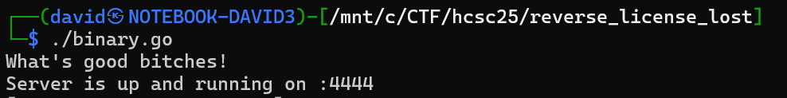
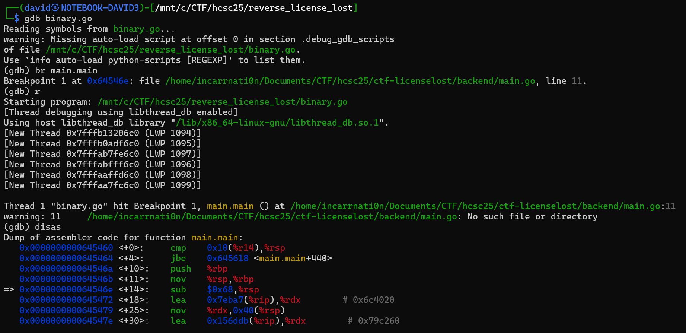
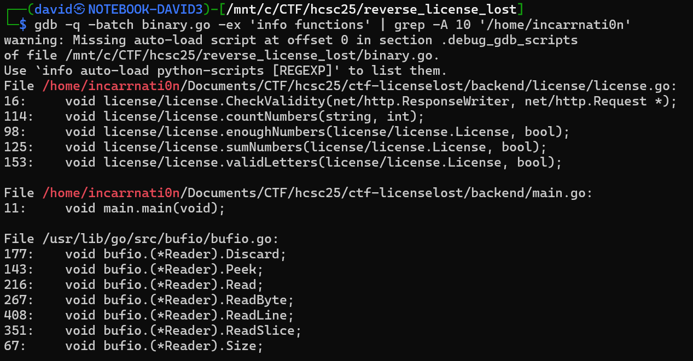
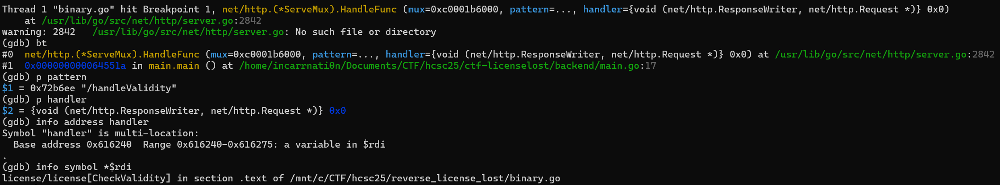
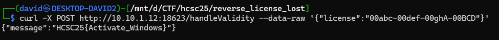

# Binary

Running the binary starts a webserver on port 4444.



It is a binary with debug info and not stripped.

```bash
file binary.go
```

```
binary.go: ELF 64-bit LSB executable, x86-64, version 1 (SYSV), dynamically linked, interpreter /lib64/ld-linux-x86-64.so.2, BuildID[sha1]=d9ce552338632ea30b3ef976a9bc7e0c2cabc48a, with debug_info, not stripped
```

# GDB

GDB can debug the go binaries well. Symbols, variables are visible.

```bash
gdb binary.go
```

```
br main.main
r
disas
```



Main reveals the developer's home folder path. Looking for other functions from that directory reveals interesting function names.

```bash
gdb -q -batch binary.go -ex 'info functions' | grep -A 10 '/home/incarrnati0n'
```



Looks like all the relevant functions are in `license/license.`.

# Handler

Stopping on the handler registration, there is 1 pattern, with 1 handler.

```
br net/http.(*ServeMux).HandleFunc
r
bt
p pattern
p handler
info address handler
info symbol *$rdi
```



# Check Validity

Next step is to recover how the check works.

```
br license/license.CheckValidity
br license/license.countNumbers
br license/license.enoughNumbers
br license/license.separatorPresent
br license/license.sumNumbers
br license/license.validLetters
r
```

```bash
go tool objdump -s 'license/license\.' binary.go
```

## POST

The handler is only accepting POST (and HEAD).

## Json 

There is some json decoding.

```
   0x00000000006449b7 <+1079>:  call   0x637160 <encoding/json.(*Decoder).Decode>
```

Go has a rigid validation, tagging the types with `json:`, which is also visible in the string.

```bash
strings -t x ./binary.go | grep 'json:"'
```

```
 2b4305 json:"license"
```

This means it accepts a structure like `{"license":"licenseString"}` and deserialised into the `license/license.License` structure. Can be accessed like this.

```
p '&license'.LicenseString
```

## Format

There is a small format check loop, every 6th character is checked for being a dash, and there should be 3 of them. It splits the serial into slices at these dashes.

```
   0x0000000000644a6b <+1259>:  lea    0x1(%rcx),%r9
   0x0000000000644a6f <+1263>:  mov    %rax,%rdi
   0x0000000000644a72 <+1266>:  movabs $0xaaaaaaaaaaaaaaab,%rax
   0x0000000000644a7c <+1276>:  mov    %rdx,%r10
   0x0000000000644a7f <+1279>:  imul   %r9
   0x0000000000644a82 <+1282>:  lea    (%rdx,%rcx,1),%rdx
   0x0000000000644a86 <+1286>:  lea    0x1(%rdx),%rdx
   0x0000000000644a8a <+1290>:  sar    $0x2,%rdx
   0x0000000000644a8e <+1294>:  mov    %r9,%r11
   0x0000000000644a91 <+1297>:  sar    $0x3f,%r9
   0x0000000000644a95 <+1301>:  sub    %r9,%rdx
   0x0000000000644a98 <+1304>:  lea    (%rdx,%rdx,2),%rdx
   0x0000000000644a9c <+1308>:  shl    $1,%rdx
   0x0000000000644a9f <+1311>:  nop
   0x0000000000644aa0 <+1312>:  cmp    %r11,%rdx
   0x0000000000644aa3 <+1315>:  jne    0x644a13 <license/license.CheckValidity+1171>
   0x0000000000644aa9 <+1321>:  cmp    %rbx,%rcx
   0x0000000000644aac <+1324>:  jae    0x644d1c <license/license.CheckValidity+1948>
   0x0000000000644ab2 <+1330>:  movzbl (%rdi,%rcx,1),%edx
   0x0000000000644ab6 <+1334>:  cmp    $0x2d,%dl
   0x0000000000644ab9 <+1337>:  jne    0x644a13 <license/license.CheckValidity+1171>
   0x0000000000644abf <+1343>:  inc    %rsi
   0x0000000000644ac2 <+1346>:  jmp    0x644a13 <license/license.CheckValidity+1171>
   0x0000000000644ac7 <+1351>:  cmp    $0x3,%rsi
```

## Checks

The other checks from the functions found earlier are also called here.

```
   0x0000000000644ad8 <+1368>:  call   0x644da0 <license/license.enoughNumbers>
   ...
   0x0000000000644af7 <+1399>:  call   0x644f80 <license/license.sumNumbers>
   ...
   0x0000000000644b17 <+1431>:  call   0x645100 <license/license.validLetters>
```

## Enough numbers

This part is counting the numbers in the slices. Anything without 2 numbers in the group is bad.

```
   0x0000000000644e37 <+151>:   call   0x644ea0 <license/license.countNumbers>
   0x0000000000644e3c <+156>:   mov    0x48(%rsp),%rdx
   0x0000000000644e41 <+161>:   add    $0x10,%rdx
   0x0000000000644e45 <+165>:   mov    0x38(%rsp),%rcx
   0x0000000000644e4a <+170>:   dec    %rcx
   0x0000000000644e4d <+173>:   cmp    $0x2,%rax
```

## Sum numbers

This one is summing the numbers in the slices. It passes when the `sum<6`.

The code can be found in [objdump.txt](workdir/objdump.txt).

## Valid Letters

This is checking each letter. Every letter must be unique. There should be exactly 8 lowercase and 4 uppercase letters. It is also adding up all the ascii values, and it should be `sum<=1200`.

The code can be found in [objdump.txt](workdir/objdump.txt).

# Ghidra

For the more complex checks, ghidra can be used as well.

# Generating serial

The check is pretty broad, and can be satisfied manually.

For the format, `00xxx-00xxx-00xxX-00XXX` was chosen, as the order does not matter much. This is passing the 2 digits per slice and 8+4 letters checks.

For the numbers, the only check is the sum being lower than 6, so using all zeroes is already passing it.

For the letters, using earlier letters from alphabet makes the sum lower. They must be unique, so using the first 8+4 letters is good enough.

The candidate is `00abc-00def-00ghA-00BCD`.

Passing this to the server via curl is exchanging it to a flag.

```bash
curl -X POST http://10.10.2.12:18623/handleValidity --data-raw '{"license":"00abc-00def-00ghA-00BCD"}'
```




# Flag

`HCSC25{Activate_Windows}`
