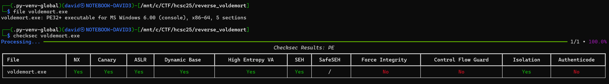
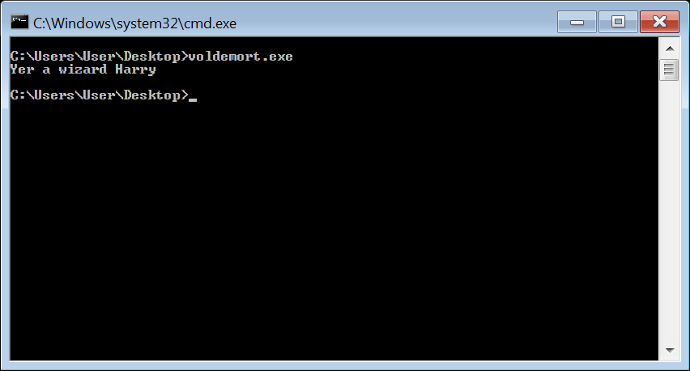
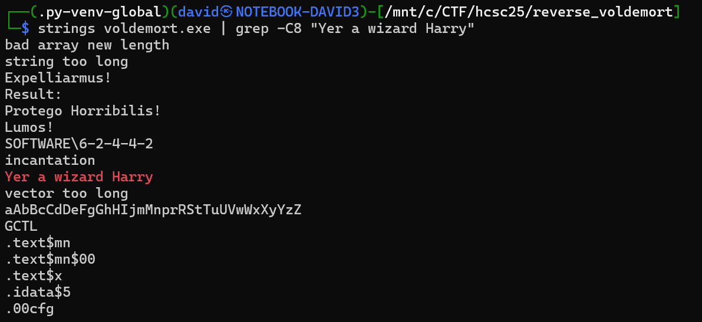
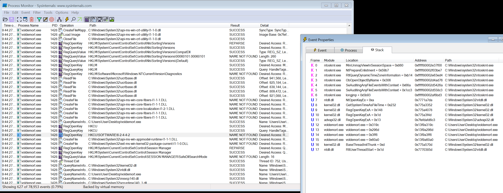
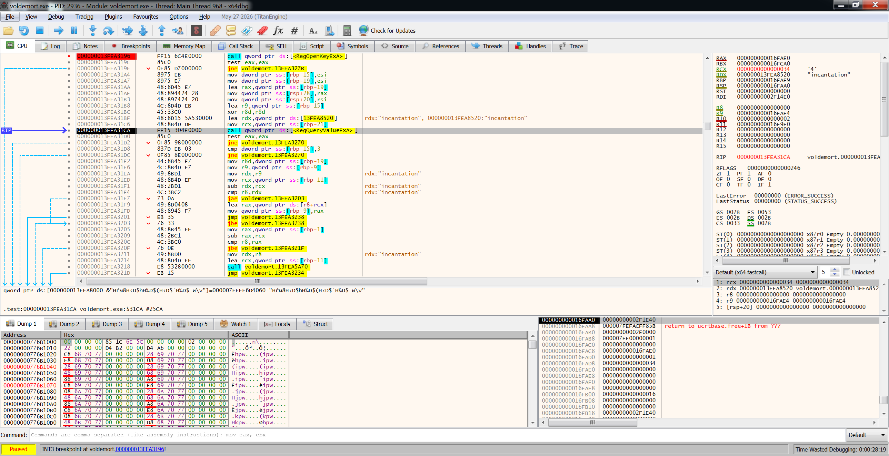
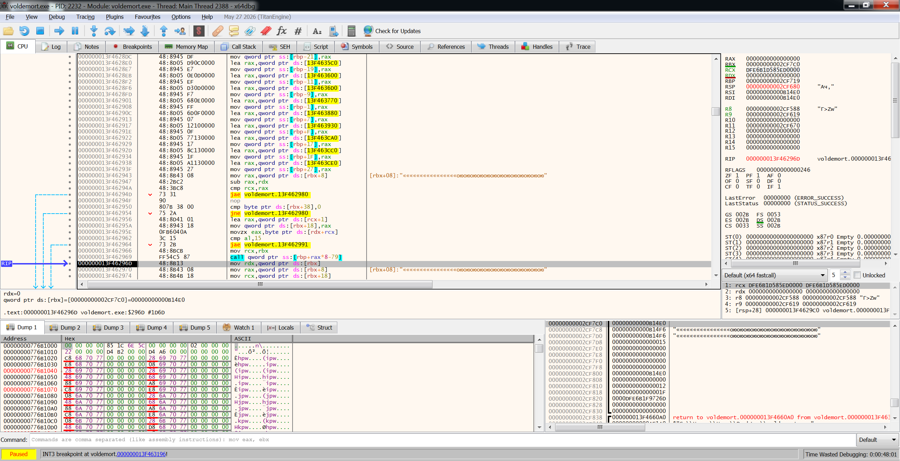
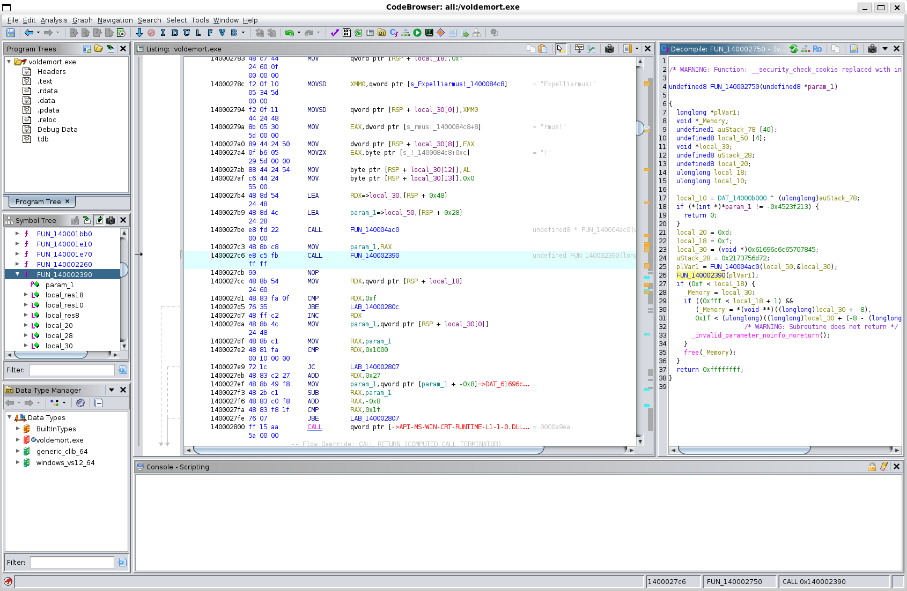
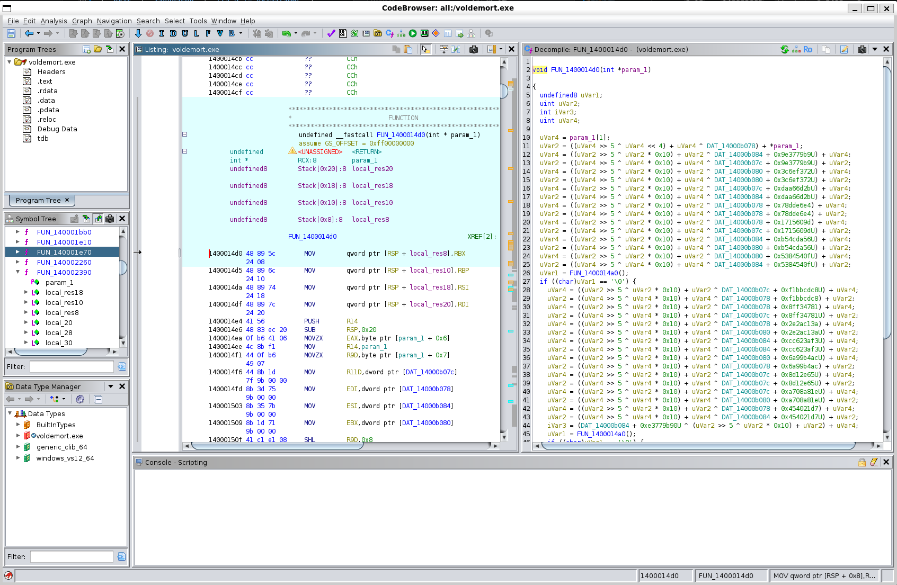
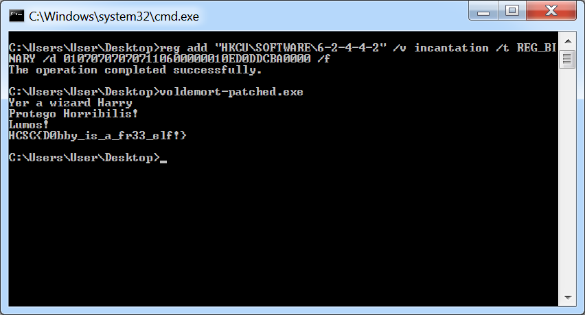
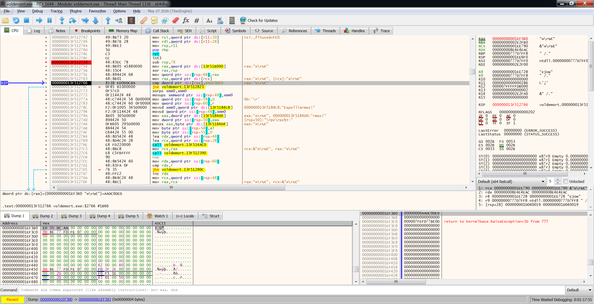

# First look

The challenge archive is protected with the password from the description, `dobbyHasNoMaster!`. Inside is `voldemort.exe`, a console application for Windows. The binary is not packed and includes standard compiler hardening.

```bash
file voldemort.exe
checksec voldemort.exe # checksec.py
```



Running it displays a Harry Potter themed message.



# Strings

The challenge description talks about casting spells in the right order, and the binary’s strings around the message immediately give away which spells might be important.

```bash
strings voldemort.exe | grep -C8 "Yer a wizard Harry"
```



- `Expelliarmus!`
- `Protego Horribilis!`
- `Lumos!`

There is also another string that looks like a registry key: `SOFTWARE\6-2-4-4-2`.

# Procmon

Running the binary under Process Monitor shows a registry query with the string found.



# The registry key

Using the decompiled [voldemort-ghidra.c](workdir/voldemort-ghidra.c) and [voldemort-hexrays.c](workdir/voldemort-hexrays.c) as reference.

Following the registry access in [x64dbg](https://x64dbg.com/) leads to some more registry operations. It is opening `HKCU\SOFTWARE\6-2-4-4-2\incantation` as `REG_BINARY` and reads the value into a buffer inside the `140003130` function.



# Dispatcher

The function returns into the `140002840` dispatcher.



It is a custom VM dispatcher, the opcodes are stored in an array. The registry read is the program itself that the VM executes.

# Spells

The 3 spell strings can be followed based on the strings. They all do some uncommon things.

## Expelliarmus

Can be found in `140002750`. It is comparing the input with the magic `0xBADC0DED`. Looking for function references, it is added in `140002e70` as `AddVectoredExceptionHandler(1, 140002750)`, so it is a vectored exception handler, checking for the exception `BADC0DED` and doing something on match. The only place that calls `RaiseException` to trigger this is `140003880`, which is checking some Thread Local Storage (TLS) values.

## Protego Horribilis

This is in `140002E70`. Actually this function was installing the exception handler found with Expelliarmus. It installs it only if some values match `0x07070707`.

## Lumos

The last spell is in `140003930`. This does a bunch of things, one strange thing is the TLS values incremented by with the `0x13579bdf` and `0x2468ace0` constants.

# Opcodes

The opcodes can be slowly reversed. 2 of the 3 spells are directly mapped there, the last is called indirectly. The functions receive 1 argument, with the VM structure (pc, stack, flags).

The TLS storage can be found at multiple places, stores a nested call flag (`tls_nested`), and 3x4 bytes of magic numbers (`tls_a`, `tls_b`, `tls_c`).

| Opcode | Function | Description |
|--------|----------|-------------|
| `0x00` | `1400029B0` | Halt |
| `0x01` | `1400029C0` | Push 4-byte on stack |
| `0x02` | `140002A60` | Add top two stack values |
| `0x03` | `140002B30` | Subtract top two stack values |
| `0x04` | `140002C00` | Multiply top two stack values |
| `0x05` | `140002CD0` | Divide top two stack values |
| `0x06` | `140002DD0` | Print top of stack as integer |
| `0x07` | `140002E70` | Protego Horribilis: validate `0x07070707` on stack, register VEH |
| `0x08` | `140002F10` | Print string with length from the program |
| `0x09` | `140003130` | Read `incantation` from registry and execute it |
| `0x0A` | `140003440` | Duplicate top of stack |
| `0x0B` | `1400034B0` | Swap top two stack values |
| `0x0C` | `1400035C0` | Push a random number to the stack |
| `0x0D` | `140003600` | XOR top two stack values |
| `0x0E` | `1400036D0` | Unconditional jump |
| `0x0F` | `140003770` | Jump if top of stack is zero |
| `0x10` | `140003880` | Expelliarmus: `tls_c = ((tls_a << 7) \| (tls_b >> 5)) ^ 0xA5A5A5A5`, raise exception with 4-byte value from the program |
| `0x11` | `140003930` | Lumos: Sets nested call `tls_nested` flag, `tls_a += 0x13579BDF`, `tls_b += 0x2468ace0`, run nested subprogram with length, then restores `tls_nested` |
| `0x12` | `140003CA0` | `tls_a += 0x13579BDF` |
| `0x13` | `140003CC0` | `tls_b += 0x2468ace0` |
| `0x14` | `140003CE0` | `tls_c = ((tls_a << 7) \| (tls_b >> 5)) ^ 0xA5A5A5A5`, no raise |

# Flag routine

There are some anti debug routines. One is checking for minimum 4 GB RAM, which also prevents the normal path without debugger. These checks can be patched out at `1400014A0`, like in [voldemort-patched.exe.bin](workdir/voldemort-patched.exe.bin).

Expelliarmus calls `140002390`.



That function is checking TLS again, after the opcodes, it is checking the `tls_nested != 0`, and also calls `140001E70`, and that is passing `tls_c` into `140001960` after converting it to string. Then it calls `1400014D0`, which looks like some encryption/decryption routine, suggesting the flag or something important.



The main question now is what should be passed to the routine.

# Reaching the routine

The minimal routine to reach the function could be the following.

```
01 07 07 07 07           # push 0x07070707
07                       # register VEH
11 06 00 00 00           # subprogram
   10 ED 0D DC BA        #   raise exception
   00                    #   halt
00                       # halt
```

```
reg add "HKCU\SOFTWARE\6-2-4-4-2" /v incantation /t REG_BINARY /d 010707070707110600000010ED0DDCBA0000 /f
```



And this is luckily printing the flag, so there is no need to play with the extra parameters.

# Flag

`HCSC{D0bby_is_a_fr33_elf!}`

# Remarks

Running it in x64dbg is actually passing `0xAADC0DED` when triggering the exception. This can be patched runtime.



Also during the competition, I missed the nested flag in the TLS, so I just patched that one as well where the program is checking it. These 2 values are not used for the decryption.

Thanks `@baltazar` for the nested incantation version.